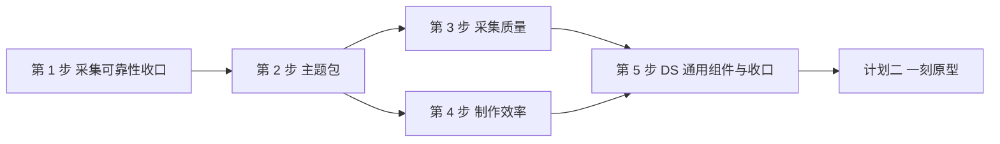

# ProtoBridge 路线图

> 本目录只记录尚未实施的计划性演进、投入与退出标准，不代表当前行为或现行 Contract。现行行为以 `docs/product`、`docs/architecture`、`docs/reference`、PBWork 手册和代码为准。
>
> 核实日期：2026-10-16。同日收敛：平台升级缩减为五步，字体与交付端适配移出范围，「主题色轴」并入「一个主题包多套主题」，组件层 Token 收缩为性格键，间距保留刻度名。

## 最终目标

PBWork 保持通用。平台升级只做对所有原型都成立的整体优化，一刻只是第一个验收样本：

1. **制作更快**：声明一次同时产出样式与证据，样板代码更少，门禁在保存时就能发现问题。
2. **采集更可靠**：失败路径如实记录，结果可复现，主题取值固定进 Evidence，键与值一一对应。
3. **原型有自己的品牌**：每个原型持有自己的主题包，可以有自己的一套或多套主题，各自含浅色与深色。

规范本身做减法：一个概念能覆盖的，不再引入两个。成本高、收益不普遍的能力，等出现第二个真实需求再做。

## 在执行的计划

| 顺序 | 计划 | 状态 | 前置条件 | 完成定义 |
| --- | --- | --- | --- | --- |
| 1 | [PBWork 与 PB 平台升级](./pbwork-platform-upgrade.md) | 执行中（第 1 步待验收，第 2 步已落地键目录与基础包、尚未接入 Runtime） | 无 | 该计划的「总退出标准」全部满足 |
| 2 | [「一刻」原型](./yike-prototype.md) | 尚未开始正式制作（产品基线与风格草稿已完成） | 计划一第 2、3、4、5 步交付的能力 | 该计划的「验收信号」全部满足，并完成正式定稿 |

平台升级的第 3 步与第 4 步都依赖第 2 步的主题包，二者可以并行。一刻默认使用第 2 步交付的主题包与第 4 步的新写法；如果某一步被缩减，必须先在[一刻计划的前置条件](./yike-prototype.md#前置条件检查)里记录替代做法，不能让一刻绕过平台约束。

两份计划可以在不同对话中分别执行。

## 未排期议题

以下议题不进入任何计划，只记录重新排期的条件。

| 议题 | 重新排期条件 |
| --- | --- |
| 组件层 Token 全量发布 | 第 2 步只交付少量「性格键」。出现第二个原型需要改动某个具体组件的形态、且性格键覆盖不了时，再把该组件的槽位提升为组件层键。 |
| Flutter / 其它端适配 | 本轮不处理。交付端需要还原时，按 Handoff 固定的键与值实现；端上命中键名，发现取值与 Evidence 不一致即视为某一环有问题。 |
| 结构整理 | 结构性拆分不改变协议。Local Service 的 `service.ts` 或其它大文件成为实际阻碍时再立项。 |
| npm 分发与许可证 | 平台升级完成且有外部采用需求后单独立项；先决定许可证与 Local Service 随 CLI 的打包方式，不把 PBWork 发布成 CLI 包。分发取舍见 [ADR 0011](../decisions/0011-producer-git-and-npm-tooling.md)。 |
| 第二道计划批准的可审计性 | 用一次真实 Handoff 画出计划版本、批准、范围变更与实施时序后，再评审独立的 Consumer Session 或 receipt；批准事实不写回 Source Evidence。 |
| Target 五维人机复查面 | 先用真实 Handoff 做一次与 Target 技术栈无关的人工 Review 试评；Target 事实保持在独立 sidecar。 |
| 官方 Flutter MCP Runtime Review | 满足 [ADR 0010](../decisions/0010-flutter-mcp-remains-experimental.md) 的实验边界，并通过[历史实验记录](../history/flutter-mcp-experiment-2026-08.md)中的 go/no-go 条件后再讨论。 |
| 多手机设备正式采集 | Core 目前只注册 `iphone-14`。有原型证明窄屏或大屏存在独有缺陷后再立项。 |
| Evidence Review 信息层级、窄屏查看与首次 setup | 平台升级后用真实采集结果重新评估是否仍是主要阻力，再决定是否立项。 |
| 基础包对比度修色 | 第 2 步之后独立进行：修正基础包 6 个不达标配对，删除对应 `contrastWaivers`，并重建视觉基线。不得混进等价迁移。 |

## 维护规则

- 每份计划自带进度表；实施一项就更新该项的状态与证据，证据写可复核的命令、测试名或固定 ID。
- 落地的能力同步写入权威文档（Product、Architecture、Reference、PBWork 手册、Skill、Schema 和测试），计划文档不替代它们。
- 计划全部完成后，从本目录移除；需要保留的设计理由写入 `docs/decisions`，迁移过程写入 `docs/history`。
