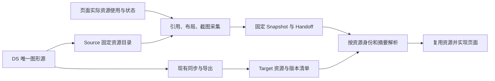

# DS 资产引用与页面采集优化方案

状态：提案，未实施。更新日期：2026-10-21。

目标：DS 同步拥有图形本体和 Target 导出；页面 Evidence 固定资源身份、版本及其实际使用方式；Target 还原复用已有资源。正常页面采集不再重新下载并归档已登记的 DS 图形，不要求 Agent 重绘。本文中的新增字段、能力和门禁均为目标设计，不代表现行 Contract。

## 已核实基线

| 当前实现 | 问题或可复用基础 |
| --- | --- |
| SVG 唯一源位于 DS glyphs；图标和主题图形分别经现有导出脚本同步到 Flutter | 复用既有同步链路，不再建立第二套图形生产机制；Flutter 接收的是生成的 PNG 和元数据，不一定是 SVG 文件本身 |
| 主题导出元数据含稳定 id、源摘要、默认 PNG、views、layers、sessionAsset、layerAsset | 已有足够基础标识默认图形和部分分层资源，需与页面实际引用对齐 |
| 图标导出清单含逐项 id、owner、尺寸、颜色策略和整集合 sourceDigest | 逐项源摘要仍需补齐，不能声称当前已支持逐图标精确版本匹配 |
| Runtime 节点含 bbox、语义父节点、顺序、组件、受控 props 和 Token bindings | 位置证据已有基础，不应为每个 SVG path 新建布局事实；bbox 是观测结果，不直接要求 Target 使用绝对定位 |
| Icon.getProps 提供 name，但 CAPTURE_PROP_KEYS 不包含 name | “已同步图标用哪一个”可能在采集时丢失；只保证截图成功不足以保证可复用 |
| 大型表盘通过 Token 选择图形，但运行时还能改选 sessionAsset 和图层 | 仅有 asset.brand-mark 不能完整说明当前实际图形、视图和动态状态 |
| Core 在 Case 执行前遍历 theme-pack 清单并下载所有资产 | 未使用主题的资产也能阻断整个 Job；下载 URL 的实现细节进入页面采集的成功条件 |
| Target resolver 主要覆盖 component/token，尚无统一的逐资产解析入口 | DS 同步检查通过，不等于独立 Target Agent 已能按固定页面证据精确找到资源 |

代码依据：[资产同步规范](../../apps/pbwork/docs/components/action/icon.md)、[图标导出](../../scripts/export-flutter-icons.mjs)、[主题导出](../../scripts/export-flutter-themes.mjs)、[Icon](../../apps/pbwork/src/design-system/components/action/Icon.vue)、[Runtime](../../apps/pbwork/src/runtime/capture-protocol.ts)、[采集器](../../packages/core/src/v2/capture/orchestrator.ts)。

## 职责划分

| 环节 | 负责的事实 | 不承担的工作 |
| --- | --- | --- |
| DS 源与同步 | 图形源、稳定资源身份、源摘要、视图和分层定义、各 Target 的生成产物及导出摘要 | 页面位置和页面状态采集 |
| PBWork Runtime | 声明节点实际使用的资源、视图、颜色策略、尺寸规则与当前状态；提供实际 DOM 观测 | 猜 Target 文件路径或导出符号 |
| Core Capture | 固定 Source 资源目录和使用引用；采集 bbox、布局关系、截图与必要状态；校验引用和完整性 | 重新导出 DS 图形，或读取 Flutter 来决定 Source 是否成功 |
| Target query/validation | 在明确 Target revision 上解析资源引用、检查版本和真实使用点 | 将 Target 同步情况写回 Source Evidence |
| Coding Agent | 使用 Target 既有公共组件和资源，按 Evidence 实现布局与状态 | 从截图重画已存在的图标，或从 Evidence Blob 另造一份相同资源 |

## 页面证据应补齐什么

建议新增 Core 所有的、带版本的资源引用和使用事实，不用自由 props 或 URL 代替身份。最终 Schema 名称在实施批次中确定。

| 内容 | 建议固定的信息 |
| --- | --- |
| 资源身份 | kind、namespace/owner、稳定 assetId、带算法的源摘要；theme 资产保留逻辑 file 与 pack 的可追溯映射 |
| 固定目录 | Snapshot 固定的资源目录修订；目录保存身份、摘要、尺寸、颜色策略及视图定义，不保存 SVG body；优先沿用 theme-pack 与 component Catalog，不为此复制一套完整目录 |
| 节点使用 | Fragment identity、资源引用、slot、所选 view/layer、实际 sessionAsset/layerAsset 关系 |
| 几何与布局 | 复用已有 bbox、语义父节点和顺序；补充确有实现意义的 fit、裁切、对齐和变换；标清视口坐标、滚动和可见裁切范围 |
| 主题与颜色 | 主题/模式、Token binding、intrinsic 或 theme 颜色策略；颜色来源不能只靠截图猜测 |
| 状态 | 当前选中层、可见性、进度等有产品意义的受控值；声明与运行时观察分开保留 provenance |

最小例子：一个页面图标应能表达“资源 icon/shared/check，源摘要 X，位于 Fragment Y，bbox 为实际观测值，大小和颜色绑定哪些 Token”。Target 再把这个引用解析为已有图标组件参数；Source 不记录 Dart 路径。

表盘必须区分“静态图形已同步”和“动态行为已实现”。进度裁切、指针旋转、水位变化仍需要状态与交互证据；不能仅凭资源已存在或一个 bbox 就宣称动态表盘已还原。真实动效过程采集沿用[既有动效证据计划](./evidence-delivery-upgrade.md)，本方案不另外建设动画引擎，也不采集整套 SVG path 让 Agent 重画。

Runtime 作者接口从现有 Inspect registration 扩展出受控资源声明；局部业务 SVG 需有可验证的显式声明通道。不能只给 name 加一个特例，也不能反向解析临时 HTTP/data URL 猜稳定身份。DOM 观测用于核对声明和实际使用，不覆盖冲突或未知。

## 采集与失败边界

1. 正常路径只固定已登记 DS 资产的身份、摘要与使用信息；不执行 storeThemePackAssets，不因清单包含未使用主题而遍历下载原文件。
2. 不删除截图采集。浏览器仍需加载页面实际使用的图片；“取消独立归档下载”不等于忽略页面图片加载失败。
3. Preflight 使用 Core 的同一资源引用规则检查声明、目录存在性及 authored required 范围；Capture 对每个实际 Case/Checkpoint 再检查一次，不能用默认态检查冒充所有状态已验证。
4. 新的资源声明能力必须在 Manifest/Consumer capability 中显式协商。旧 Runtime 缺字段时不能默认推导为“没有资产”，旧 Consumer 不能静默漏读新的 required 引用。
5. 新快照保持与 Target 无关；Target 尚未同步不会导致 Source Capture 失败，但会阻止 Target 端声称资源可精确复用或还原已完成。

| 情况 | 处理位置与结果 |
| --- | --- |
| 页面所用 DS 引用存在，资源能正常显示 | 正常采集引用、布局、状态和截图，无独立原文件下载 |
| required 节点资源身份缺失、引用未知、冲突，或实际图像无法显示 | Preflight 可见时阻断；Case 执行时发现则该 Case 失败，保留其他成功 Case |
| 未选中主题或未使用图形的下载地址不可用 | 页面采集不下载该地址，不因独立归档请求失败而终结 Job；主题解析和已有跨模式一致性检查仍执行 |
| Target 缺资源或版本不符 | Target query 返回 unresolved/stale/conflict 等明确结果，提示执行 DS 同步；不能静默选择相似图形或让 Agent 重画 |
| 未登记外部图片、远端资源或独立业务附件 | 如实报告未覆盖的资源依赖，不能冒充 DS 引用；required 且无既有可固定交付方式时阻止完整声明；通用外部资源打包另行设计 |
| Screenshot、必要 Evidence 或 Store 提交失败 | 保留现行必要性、失败与原子提交规则 |

新资源诊断由 Core 定义稳定 code，携带 Screen、Variant/Checkpoint、Fragment、assetId 与阶段；Local Service 和 PBWork 只转发和展示。资源同步缺口、页面观测失败、Store 失败分别说明，避免全部只显示 failed。

## Target 消费与验证

- Source 目录与 Target 导出清单使用同一资源身份。对主题图形按 pack/asset/view 对齐；图标补逐项源摘要。保留已有摘要算法并标注算法，不为本轮强行重算所有历史身份。
- 元数据保存 source digest 与 Target 产物 digest，SVG 转 PNG 后不直接比较两者字节摘要。解析同时检查源版本、导出配置和实际 Target 产物，不能只信“清单存在”。
- 通过栈无关 Target 门面提供按需资源解析，Flutter adapter 读取自己的图标/主题导出清单和公共入口。无需业务组件时可解析为已有资产路径及使用约束；不能要求新增一套图标实现。
- Handoff/Screen packet 给出当前选中页面的资源依赖；资源使用差异进入 Case delta。默认不倾倒整个 DS 目录。
- 扩展实际采用映射的验证，核对本次页面使用了正确资源、版本、view 与颜色策略；不能用工程某处存在同名 PNG 代替真实使用。
- Prompt 与消费纪律明确：已解析资源直接复用；缺失先处理同步或版本问题；不得通过重绘、复制 Blob、自动导出掩盖未解决的 Target 缺口。

引用交付的可复现边界需明确：固定目录、使用事实与截图可以独立读取，但没有归档字节就不能承诺任意历史 SVG 原稿都可离线取回。Target 必须已有与固定摘要相符的同步产物，或通过 DS 的受控版本来源恢复该版本；缺少历史版本时明确报告资源不可复用，不能回退最新资源。本轮不建设资源服务器或自动历史版本下载系统。

## 上一轮补丁的取舍

当前工作区的兼容修复仍保留，本文不执行回退。实施时按以下原则收口，避免把临时修复固化成第二条资产分发链路。

| 改动 | 方案中的处理 |
| --- | --- |
| Local Service 展示 Job journal 的真实失败原因 | 保留，并补稳定诊断 code 与页面/资产上下文 |
| PBWork ?url&no-inline | 可保留，确保预览和原稿读取使用正确字节；页面采集成功不再依赖独立下载该 URL |
| Core data URL 读取与逐文件下载 | 正常 DS 引用路径移除；只有另有明确既有调用需求时才保留专用读取器，不新增默认归档开关 |
| 新增 stageJobCatalogAssets、catalog-assets staging 与特殊 commit 分支 | 在确认全部调用点后移除不再需要的新增链路；保留通用 Case staging 和不可变提交保障 |
| 现有 theme-asset Blob 与历史 Catalog 引用 | 保留 Schema/Reader/可达性和清理兼容，不重写或删除旧 Store、Snapshot、Handoff |
| 以“成功下载 8 个 SVG”作为回归结论 | 改为资源引用、实际使用与 Target 复用闭环；69 个 Case 成功仅证明上一轮兼容修复，不能证明本方案完成 |

## 实施批次与目标投入

以一名熟悉仓库的工程师估算 5–8 个有效人日；这是初始范围估算，Contract 核对后修订，不等于完成承诺。本轮只制定方案。

| 批次 | 工作与范围 | 依赖 | 估算 | 退出标准 |
| --- | --- | --- | --- | --- |
| A：固定资源引用与页面使用 | Core 引用/诊断模型、Catalog 元数据、Runtime/Inspect 作者接口、Icon 与表盘代表实例、固定 Facts、能力协商和 MCP 按需读取 | 无 | 2–3 人日 | 默认图标名称不会丢失，过程版与图层实际引用可从固定 Evidence 读取；无 URL 猜测 |
| B：采集解耦与历史兼容 | 删除正常路径全包下载和无用新增 staging；分清 Case/Target 故障；读旧 Blob；同步采集规范与范围测试 | A | 1–2 人日 | 不下载 DS 原文件仍能完成首 Bundle；必要资源异常仍准确阻断受影响 Case；旧固定引用可读 |
| C：Target 复用闭环 | 补逐资产摘要/产物校验、Target 资源解析和真实使用验证、Screen packet/delta、消费纪律、独立 Target 回归 | A、B | 2–3 人日 | Agent 能按当前页面精确复用已有资源，缺失/旧版明确报告，全产品回归完成 |

每批同时交付 Schema、实现、测试和相应当前文档；单独取消下载不算完成。A/B 可在开发中交错，正式默认路径切换需 A、B 同时通过；整个优化完成还需 C。

涉及 Runtime/持久 Schema 的版本号由实施时的统一版本方案确定，与既有文档/动效能力升级协调，不在本提案抢占版本号。Case identity 与历史 scope digest 不因资产引用新增而改写；新产物的输入摘要与能力声明必须使旧的“缺引用”Evidence 不被误复用为完整新结果。

## 验证与完成标准

| 验证 | 期望结果 |
| --- | --- |
| 相同图标不同位置/实例 | 稳定资源引用相同，Fragment 和 bbox 独立；图标名称不被白名单丢弃 |
| 同一页面切换图标或视图 | 页面 delta 明确记录资源/view 变化，无需新增 SVG Blob |
| yike 默认/过程版/暂停/休息 | 对应实际 asset、sessionAsset、layerAsset、view 和当前状态；静态图层不冒充完整动画 |
| 独立归档故障注入 | 保持页面正常渲染，令额外原文件读取不可用；正常 DS 引用 Capture 不调用该读取路径，仍能完成 |
| 必要可见图像加载失败 | 受影响 Case 明确失败，保留成功 Case，不能用“已取消归档”掩盖缺图 |
| Target 已同步 | 精确解析现有资源及公共入口，核对本次真实使用；无重新绘图或第二次导出 |
| Target 缺失/过期/清单与文件漂移 | 只在 Target 解析/验证阶段给出可核对的缺口；Source Evidence 保持不变 |
| 固定与历史 | 修改当前源文件或 Target 清单不改变旧 Evidence 的引用解释；旧 theme-asset Blob 仍按固定引用可读 |
| 生命周期与故障 | 首 Bundle、重采、复用、取消、中断恢复、截图失败及提交失败保持既有保证；新能力缺失不被静默算完整 |

按范围运行 Core Capture/Store/Consumer、PBWork Runtime、Target resolver 与 MCP 测试；真实浏览器验证开发与构建环境的代表页面，再验证 yike 整原型与独立 Flutter Target 的资源复用。完成时运行 pnpm docs:verify、pnpm consumer-contract:verify、pnpm ds:target-sync:verify 与 pnpm verify；Flutter SDK 等环境阻塞单独记录，不以局部通过替代完整产品结果。

## 文档同步与范围约束

实施时同步 Evidence 模型、采集链路、主题包模型、Core/MCP README、语义标记与 Authoring Contract、PBWork Icon/Theme 手册、检查单、相关 Skill 以及 Target 资源约定。现行文档在实现落地时修改，不把本提案写成已执行规则。

投入不足时依次后移批量自动修复同步、额外资源预览 UI、更多 Target adapter 和通用外部资源打包；保留固定引用、页面使用事实、正常采集解耦、明确故障边界、Target 精确复用及历史兼容。不增加从 SVG 反推绘图算法、全量 DOM 路径采集或默认复制资产到业务工程。

实施状态：A、B、C 均待实施；本方案文档不是采集架构已经完成优化的证明。
