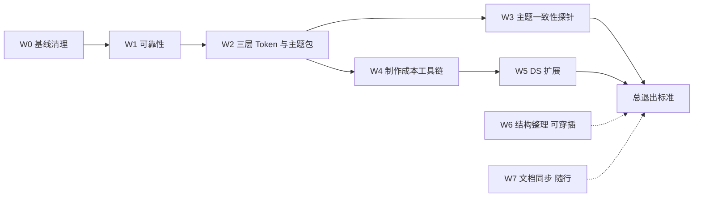

# PBWork 与 PB 平台升级

> 状态：未开始；核实日期：2026-10-16。本文是计划，不代表现行 Contract。完成后按 [路线图维护规则](./README.md#维护规则)把现行行为写入权威文档。
>
> 本计划不制作新原型。「一刻」原型见[下一份计划](./yike-prototype.md)，以本计划达到「总退出标准」为前置条件。

## 目标

把 PBWork 从“能产出可采集原型”提升为“能高效产出有自己品牌、可直接交付的原型”，同时补齐 PB 在 Evidence 完整性与可靠性上的已知缺口。四个方向：

1. 修复已证实的 Core / Service 可靠性问题，使「Evidence 就是产品」在失败路径上也成立。
2. 主题从“全局一套皮肤”改为“PBWork 定键名、原型定键值”的三层 Token 与主题包。
3. 用主题一致性探针替代多主题采集：Evidence 记录键名，主题取值由主题包固定。
4. 降低原型制作成本，并按通用 App 需要扩展 DS。

## 范围约束

- **不兼容现有原型。** 恒动原型直接移除，不迁移。冷链原型保留，作为回归验证样本，并迁移到本计划的新写法；冷链在迁移中出现的报错按新规则修复，不为旧写法保留兼容层。
- **Flutter Target 采用“PBWork 先行”。** `apps/flutter_pb_app` 只适配三层键名与基础主题包取值，保证冷链在 Target 中仍可编译、测试通过；本计划新增的 DS 组件在 Target 映射中显式标为 `pending`，漂移状态如实显示，不在本计划内补齐 Flutter 组件。
- **Core 仍是唯一语义层。** 主题包身份、Theme 一致性判定、`pending` 状态等新语义都由 Core 定义；PBWork、CLI、MCP 与 Local Service 只适配。
- **不做的事：** 多手机设备正式采集、Evidence Review 信息层级与窄屏、首次 setup、npm 分发（均在[未排期议题](./README.md#未排期议题)）。

## 进度

| 工作流 | 状态 | 证据 / 剩余缺口 |
| --- | --- | --- |
| W0 基线清理 | 未开始 | — |
| W1 Core 与 Service 可靠性 | 未开始 | — |
| W2 三层 Token 与原型主题包 | 未开始 | — |
| W3 主题一致性探针 | 未开始 | — |
| W4 降低原型制作成本 | 未开始 | — |
| W5 DS 扩展 | 未开始 | — |
| W6 结构整理（可选） | 未开始 | — |
| W7 文档、Skill 与 ADR 同步 | 随各工作流进行 | — |



W3 与 W4 都依赖 W2 的主题包身份，二者可以并行。W5 的组件要用 W4 的新写法与 W2 的组件层 Token，因此排在最后。

---

## W0 基线清理

### 问题与证据

- 恒动原型体量大（`registry.ts` 中约 2200 行，10 个 Screen、101 个 Case），迁移到新写法的成本高于价值；它的引用散布在 Workbench、单测、E2E 和 Core 测试中。
- 旧 Capture 路径仍留在源码中：`apps/pbwork/src/capture/DeliverFlowSheet.vue` 没有生产 import；`LifecycleTransitionDialog` 的 finalize 分支不可达（调用方在 `intent === 'finalize'` 时挂载的是 `LifecycleFinalizationSheet`，见 `workbench/views/PrototypeOverview.vue` 与 `PrototypeGallery.vue`）。
- 本地 `proto-bridge.json` 的 `capture.maxCases` 为 100，小于 Core 默认值 200（[workspace-config.ts](../../packages/core/src/v2/workspace-config.ts) 第 25–26 行）。该文件不进 Git。

### 方案

1. 删除恒动：
   - `apps/pbwork/src/prototypes/hengdong/` 与 `apps/pbwork/src/drafts/hengdong/`；
   - [registry.ts](../../apps/pbwork/src/prototypes/registry.ts) 中的恒动 `PrototypeRecord` 与全部恒动 Screen 记录；
   - Workbench 中的硬编码入口与展示：`workbench/navigation.ts`、`workbench/prototypes/prototypePresentation.ts`、`drafts/workbench-overview/data.ts`、`drafts/workbench-overview/variants/QueueDirection.vue`、`drafts/registry.ts`；
   - 只服务恒动的单测：`apps/pbwork/test/hengdong-*.test.ts`；
   - 以恒动为样例的测试改用冷链：`capture-store`、`router`、`theme-preference`、`runtime-url`、`registries`、`work-map`、`prototype-presentation`、`result-classification-presentation`、`capture-presentation`、`review-copy`、`screen-transition`、`workbench-navigation-tree`；
   - E2E 改用冷链：`workbench-navigation.spec.ts`、`runtime-capture.spec.ts`、`canvas.spec.ts`、`finalization-regression.spec.ts`；
   - Core 测试样例改用中性 fixture：`packages/core/test/v2/result-classification.test.ts`、`packages/core/test/v2/capture/runtime-contract.test.ts`。
2. 删除旧 Capture 死代码：先生成 production import graph，再删除 `DeliverFlowSheet.vue`、`LifecycleTransitionDialog` 的 finalize 分支、`app/stores/capture.ts` 中只被它们调用的 action / state，以及只保护这些入口的测试。CLI、Core、Local Service 的 Selection、retry、Bundle 管理等公开能力保留。
3. 本地 `proto-bridge.json` 把 `capture.maxCases` 改为 200，然后执行 `pnpm pb:reset` 清空旧 Store。在 [getting-started](../guides/getting-started.md) 中确认 `pb:init` 的默认值说明一致。

### 退出标准

- 仓库内（`docs/history` 除外）不再有 `hengdong` / 恒动引用；`rg -i "hengdong|恒动" --glob '!docs/history/**'` 无结果。
- `pnpm verify` 全绿；冷链完整定稿一次（Job 全部 captured，Handoff 与 Delivery 绑定，stage `final`）。

---

## W1 Core 与 Service 可靠性

每一项都必须带回归测试或故障注入用例；先写能在旧实现上复现问题的测试，再修。

| # | 问题与证据 | 方案 |
| --- | --- | --- |
| 1 | 在 `awaiting-risks` 阶段，每秒一次的对账（[service.ts](../../packages/local-service/src/service.ts) 第 377–381 行的定时器）都会调用 `evaluateHandoffForSnapshot`（第 1126–1144 行），其中 `runPreflight` 在生产路径启动 Chromium（`runtime-preflight.ts` 第 64–74 行），`createStalenessReport` 每次生成新的 `reportId`（第 1190–1195 行）。用户停留在确认面板越久，CPU 与 `staleness-reports/` 文件越多。 | 按 `bundleId + snapshotId + inputVersion` 缓存评估结果；只在用户提交确认、或 manifest / inputVersion 摘要变化时重算；StalenessReport 只在构建 Handoff 时写入。测试断言：确认面板停留 N 个 tick 期间 Preflight 调用次数为 1，报告文件数不增长。 |
| 2 | Blob（截图等）与 Issue 写入失败只记入 journal，Job 照常 `finalizeJob`（[orchestrator.ts](../../packages/core/src/v2/capture/orchestrator.ts) 第 470–497 行）。Case 可能显示 captured 但没有截图。 | 必需 Blob（截图）写入失败时，受影响的 Case 记为 failed 并进入 Coverage 与失败分组；Issue 写入失败让 Job 进入可见的失败终态。用故障注入 Store 测试两种失败。 |
| 3 | 采集中途崩溃丢失全部已完成 Case：attempts / revisions / binaries 都在内存中（orchestrator 第 186–188 行），只在全部 Case 跑完后提交；重启时 `finalizeOrphanJobs`（`local-file-store.ts` 第 1171 行起）只生成零 Attempt 的 interrupted Run。 | 每个 Case 完成后把 revision 与 Blob 写入 Job staging；孤儿恢复从 staging 提交已完成 Attempt，其余 Case 标为 interrupted，Coverage 如实为 partial。故障注入：在第 k 个 Case 后 kill，重启后 k 个 Case 可读。 |
| 4 | `writeImmutableBytes` 只做写临时文件加 rename，没有 fsync（[atomic-file.ts](../../packages/core/src/v2/store/atomic-file.ts) 第 89–109 行），而 JSON 写入有文件与目录 fsync。 | 对齐 `writeJsonAtomic`：写临时文件、fsync、rename、目录 fsync。 |
| 5 | `pnpm pb:up` 忽略 `service.host`、`service.allowedOrigins` 与 `store.maxBytes`：[local-service/src/index.ts](../../packages/local-service/src/index.ts) 第 29–35 行写死 `127.0.0.1`，Origin 只取 `PBWORK_ORIGIN`；`scripts/pbwork-dev.mjs` 第 56–65 行不传这些字段。CLI `service start` 是按配置启动的（`packages/cli/src/cli.ts` 第 1610 行起）。 | `pb:up` 与 CLI 共用同一份由 Core 解析的配置启动 Service（host、port、allowedOrigins 回退规则、maxBytes、maxCases），不再各自拼环境变量；`pb:doctor` 检查项与实际启动参数一致。 |
| 6 | Delivery GET 只拒绝 `/` 与 `\`，没有拦截 `..`（service.ts 第 2502–2514 行）。同文件迁移路径已有白名单（第 809 行）。 | 抽出共享的 Delivery ID 校验（白名单正则、拒绝 `.` 与 `..`、`pathRelative` 包含检查），两处复用。 |
| 7 | 配置允许 `retainArchivedSnapshots` 为 0（workspace-config.ts 第 48 行 `.min(0)`），`planClean` 却要求至少为 1（`local-file-store.ts` 第 1984–1992 行）。 | Schema 改为 `.min(1)`，并同步[配置参考](../reference/configuration.md)。 |
| 8 | `CaptureJobHost.accept`（`job-host.ts` 第 42 行起）不限制并发 Job，Store 的 `commitRun` 没有进程级写队列。是否会造成同一 Bundle 的 active 指针竞态尚未证实。 | 先写两个 Job 同时提交同一 Bundle 的回归测试；证实则加 Workspace 级单飞执行器（同时只运行一个 Capture Job，其余排队并可见）。另外增加 Host 头本机校验，作为 DNS rebinding 的纵深防御。 |

### 退出标准

- 8 项各有对应测试；第 1、2、3 项的测试在旧实现上失败、在新实现上通过。
- `pnpm verify` 全绿。

---

## W2 三层 Token 与原型主题包

### 问题与证据

- 键名多为刻度名而不是语义名：`spacing.sm-plus`、`radius.lg`、`layout.half-negative`。组件代码自行选择刻度档位，按钮形状、Tab 质感等“性格”被写死在组件里，主题无法改变。
- 字体没有独立的键：`typography.title` 的值是 `"650 20px/1.3 Inter, system-ui, sans-serif"`，字族、字重、字号、行高揉在一个复合字符串中；全部 13 个 typography Token 都是 Inter。
- `PrimaryTabs` 直接使用 `LiquidGlass`，表面质感不可主题化。
- 只注册了两套全局主题：`loaders.ts` 第 24–26 行只返回 `light` 与 `dark`；`createVuetifyThemes.ts` 第 22–40 行要求且只认这两个 ID。原型无法拥有自己的品牌色板，所有原型都长得像 PBWork。
- Capture 用 `themeId === 'dark'` 推导 `colorScheme`（`playwright-driver.ts` 第 695–697 行）；Theme 只是一个字符串 ID，不能表达“哪个原型的哪套取值”。

### 方案：键名归 PBWork，键值归原型

| 层 | 谁定义键名 | 谁给键值 | 组件与 Evidence 能否引用 |
| --- | --- | --- | --- |
| 原始层：色板、字族、刻度 | 主题包自己 | 主题包 | 不能，只供本包内部引用 |
| 语义层：`color.primary`、`font.numeric`、`radius.surface`、`density` 等 | PBWork | 主题包，缺省继承基础包 | 能 |
| 组件层：`button.shape`、`tabbar.surface`、`ring.stroke` 等 | PBWork，随组件 Contract 发布 | 主题包，默认指向语义层 | 能 |
| 常量：`layout.*` 等实现常量 | PBWork | PBWork，不可主题化 | 只供组件实现 |

1. **重构键名目录。** 在 `design-system/tokens` 中为每个 Token 增加 `tier`（`semantic` / `component` / `constant`）。新增并拆分语义键：
   - 字体：`font.text`、`font.display`、`font.numeric`（启用 `tnum` 等宽数字），字重、字号、行高拆成独立键；`typography.*` 改为引用这些键的组合角色；
   - 形状与密度：`radius.control`、`radius.surface`、`density`；
   - 表面与动效性格：`surface.treatment`（实底、描边、毛玻璃）、`motion.personality`；
   - 资源：`asset.*`，用于随模式变化的 Logo 或插画。
   刻度名（如 `spacing.sm-plus`）降为原始层或常量，组件不再直接消费；`LiquidGlass` 改由 `surface.treatment` 驱动。
2. **组件层 Token 随 Contract 发布。** 每个组件 Contract（`components/contracts/*.json`）声明自己的组件层槽位与默认引用，`registry.ts` 的 `tokenBindings` 绑定组件层键。
3. **主题包格式与位置。**

   ```text
   design-system/theme-packs/base/        PBWork 基础包，由现有 tokens.json、light.json、dark.json 迁移
   prototypes/{prototypeId}/theme/
     pack.json         包 ID、继承的基础包、声明的模式与主题色轴
     primitives.json   原始层取值（包内私有）
     semantic.json     语义层取值，按 light / dark 两种模式给出
     component.json    可选：组件层取值，改变组件形态
     accents.json      可选：主题色轴，只能覆盖 pack.json 声明的 accent 键子集
     fonts/            本地 woff2 字体与许可证，保证离线可用
   ```

4. **主题包校验器（Core 定义规则，PBWork 与脚本调用）。** 检查：语义层与组件层键名覆盖完整（缺省项从基础包继承并在 Workbench 标出“沿用基础值”）、引用可解析、无循环引用、各组前景/背景配对满足 WCAG AA、主题色只覆盖声明子集、字体文件有许可证说明。不允许新增 PBWork 未定义的键名。
5. **主题身份与 Runtime。** 主题身份记作 `packId@digest / mode / accent`，`mode` 取 `light`、`dark` 或跟随系统。改造 `runtime/theme-preference.ts`、`RuntimeLayout.vue`、`resolveThemeTokens.ts`、`createVuetifyThemes.ts`，按当前原型的主题包生成 CSS 变量与 Vuetify 主题；Capture 的 `colorScheme` 从 mode 推导。Workbench 的工作台主题仍是独立通道。
6. **Workbench 预览。** Token Gallery 与 Component Playground 可选择主题包、模式和主题色，用该包渲染全部 DS 组件，便于评审“这个原型像不像它自己”。
7. **Evidence 与交付。**
   - Core 在 Bundle 与 Handoff 中固定主题包的 digest 和完整取值表（覆盖全部模式与主题色）；Case 中记录的已解析值来自默认模式。
   - `runtime/inspect/snapshot.ts` 中“已解析值是否与 Token 取值一致”的比对改为按当前主题包解析。
   - MCP 增加读取固定主题包取值表的入口，仍只从固定 Handoff 可达，不回退 active/latest；同步 [MCP README](../../packages/mcp-server/README.md)。
   - `scripts/verify-ds-target-sync.mjs` 从“比对 light/dark 两份全局主题的 digest”改为检查分层键名覆盖与每个包的取值漂移。
8. **Flutter Target。** `apps/flutter_pb_app/lib/theme/ts.dart` 与 `proto_bridge_tokens.dart` 适配新键名，取值来自基础包；冷链在 Target 中编译与测试通过。同步 Target 的 `docs/theme.md` 与 `proto-bridge.target.json`。

### 退出标准

- 冷链使用基础包，视觉与迁移前一致（以迁移前后的 default 截图人工比对）。
- 另建一个示例主题包（只用于 Playground，不是正式原型），与基础包在字体、圆角、表面质感和主色上都不同；Playground 中两包对比能一眼看出差异。
- 校验器对缺键、循环引用、对比度不足、越权覆盖各有失败用例。
- 冷链定稿生成的 Handoff 可通过 MCP 读到主题包 digest 与取值表。
- `pnpm ds:target-sync:verify` 通过。

---

## W3 主题一致性探针（取代多主题采集）

### 背景

Evidence 记录的是 Token 键名与绑定关系；[语义标记规则](../reference/semantic-authoring.md)规定 Theme 只改变 Token 值、不改变 binding；Target 按同一套键名取值。因此深色等其它模式不需要再采一遍 Case。这个结论成立需要两个前提：页面结构不随主题变化，所有可见设计量都走 Token。本工作流用便宜的检查守住这两个前提。

### 方案

1. **探针。** Preflight 时对每个 Screen 的 default Variant，在主题包声明的每个模式下各渲染一次，断言语义树（节点 identity、role、可见性、bbox 是否非零）与 Token 绑定完全一致。出现分叉即阻断，并报告分叉的 Screen 与节点。探针结果是 Preflight 诊断，不写入 Evidence。主题色轴只换 accent 键，不改变结构，不单独探测。
2. **随主题变化的资源走键名。** Logo、插画等需要按模式切换时，声明为 `asset.*` Token，不在代码中按模式分支；探针会把代码分支导致的结构差异报出来。
3. **Case 只采默认模式。** 原路线图中“多 Theme 正式采集”的设想作废；多设备是独立议题，见[未排期议题](./README.md#未排期议题)。
4. 一致性判定属于 Core 语义，PBWork 只呈现结果。

### 退出标准

- 在冷链中临时注入一处“深色模式下隐藏节点”，探针阻断并指出该节点；移除后通过。
- 冷链所有 Screen 在 light / dark 下通过探针。
- [采集链路文档](../architecture/capture-pipeline.md)与语义标记规则写明：主题不进入 Case 矩阵，由探针与主题包固定取值保证。

---

## W4 降低原型制作成本

### 问题与证据

以即将移除的恒动为样本：

- 每个证据节点要手写 `data-pb-id`、`data-pb-role`、`data-pb-key` 与 `data-pb-token-*`（共约 120 个 `data-pb-id`、245 个 token 属性），同一 Token 还要在 CSS 中再写一遍 `var(--pb-*)`（`hengdong.css` 1451 行）。规则明确 CSS 使用 Token 不会自动形成证据，两处必须手工保持一致。
- `registry.ts` 中每个 Fragment 和 Action 目标都重复写 `screenId` 与 `pbId`，恒动一份就约 2200 行。
- `nav.ts`、`storage.ts`、外壳组件、主题偏好同步每个原型都要重写。
- 时钟由 Core 写死为 `2026-07-28`（`playwright-driver.ts` 第 703 行），原型只能自己再硬编码一个“今天”。
- 没有脚手架；门禁问题要等整份 Preflight 才暴露。

### 方案

1. **一次声明，同时产出样式与证据。** 提供 `v-pb` 指令与 `pbStyle()`：

   ```vue
   <span
     v-pb="{ id: 'remaining', role: 'text', key: habit.id }"
     :style="pbStyle({ color: 'color.on-surface-muted', typography: 'typography.caption' })"
   >
     还差 2 次
   </span>
   ```

   一次声明生成 CSS 变量、`data-pb-id` / `role` / `key` 与 `data-pb-token-*`；只接受已注册的语义层与组件层键名，类型检查拒绝未知键。DS 组件实例继续由 Registry 提供绑定。
2. **Registry 就近声明并自动汇总。** 每个 Screen 目录放 `screen.ts`，用 `defineScreen()` 与 `frag('next-action')` 自动补全 `screenId` 与 pbId 前缀；`registry.ts` 改为 glob 汇总。`v-pb` 标为 `required` 的节点在构建时生成 default Variant 的完整性边界，生成文件提交进仓库，便于审阅 diff。这仍是作者显式声明的边界，符合 authored completeness boundary 红线。
3. **共享原型运行套件 `createPrototypeApp`。** 提供：带 schema 版本的本地存储、进入/返回/替换导航（保留 `pbParent`）、主题包与模式/主题色偏好同步、Tab 外壳、启动页插槽、可声明时钟。原型只写业务模型与页面。
4. **可声明时钟。** 原型在 manifest 中声明固定的“现在”（时间与时区）；Core Capture 按声明安装时钟，替代写死的日期；共享 `useClock()` 在交互模式走真实时间，在采集模式走声明时间。时钟声明进入 Preflight inputVersion。
5. **脚手架。** `pnpm pb:new-prototype <id>` 生成目录结构、主题包模板、`docs/design.md` 模板（`status: draft`）、外壳、一个示例 Screen、`screen.ts` 与测试。
6. **实时门禁。** 在现有 `authoring/diagnostics.ts` 与 Inspector 基础上，Workbench 按当前 Screen 实时显示缺节点、缺 role、缺 Token Evidence、零 bbox、遮挡等问题，保存后即可见。实施前先确认现有诊断的覆盖范围，只补缺口。

### 退出标准

- 冷链三个 Screen 迁移到新写法，在本计划进度表记录迁移前后的 Screen 代码、CSS 与 Registry 行数。
- 脚手架生成的空原型无需手改即可通过 Preflight 并完成一次定稿。
- 声明时钟后，同一 Case 两次采集的时间相关文字与截图一致。

---

## W5 DS 扩展

### 原则

按通用 App 的需要规划组件，不以某个实验原型是否做过为依据。每个组件都要有 Contract、Registry、Playground、单测，遵守 Flex-only 与只用 Token 的红线，使用 W4 的新写法与 W2 的组件层 Token。

### 第一批

| 类别 | 组件 |
| --- | --- |
| Foundation | W2 新增的语义键在全部现有组件上落地 |
| 输入 | SegmentedControl、Stepper、Slider、DurationPicker（滚轮）、TimePicker |
| 展示 | RingProgress（确定进度环）、Metric（数字加单位加变化量）、NumberTicker（减少动效时直接切换）、Heatmap、MonthCalendar、MiniBars、Tag |
| 列表 | GroupedList、ListCell（前置图标，主副标题，尾部值、开关或箭头） |
| 反馈 | 带撤销动作的 Snackbar、带档位的 Sheet、ActionSheet |
| 导航与品牌 | FAB、LaunchScreen 模式、BrandMark 插槽 |

### 第二批

SwipeActions、LargeTitleHeader、Timeline、DatePicker、ColorSwatchPicker、Banner、完成反馈层、PageIndicator。第二批可以在计划二进行中按需提前，但必须满足同样的门禁。

### Target 的 `pending` 状态

- `proto-bridge.target.json` 支持为组件或 Token 显式声明 `status: "pending"`。
- `ds:target-sync:verify` 报告 pending 数量与清单，不因 pending 判失败；未声明又缺失的项仍判失败。
- MCP `resolve_target_components` / `resolve_target_tokens` 对 pending 项如实返回“Target 待实现”，不猜测替代组件。
- pending 语义由 Core 定义，同步 [Target 映射参考](../../apps/flutter_pb_app/docs/proto-bridge.md)。

### 退出标准

- 第一批全部组件在 Playground 中可用基础包与示例主题包分别渲染，覆盖浅色与深色。
- `pnpm verify` 全绿，`ds:target-sync:verify` 输出的 pending 清单与第一批组件一致。

---

## W6 结构整理（可选）

- [service.ts](../../packages/local-service/src/service.ts) 约 2700 行，`handle()` 是单一 if 链路由。按 session、jobs、lifecycle、review、delivery、workspace 拆成独立模块，共享鉴权与错误处理。
- 只做结构拆分，不改变协议；以 Local Service 现有测试全绿为准。可以在 W1 之后的任意时点穿插进行。

---

## W7 文档、Skill 与 ADR 同步

随各工作流同步，不集中到最后：

- `AGENTS.md` 红线：“具体值只存在于 Foundation/Theme”改为“具体值只存在于主题包”；补充主题一致性与 `v-pb` 写法的要求。
- [语义标记与证据门禁](../reference/semantic-authoring.md)、[原型 Authoring Contract](../reference/prototype-authoring.md)、PBWork Skill 的 references、`apps/pbwork/docs/checklist.md`、Token 与 Theme 手册、组件总论。
- [Evidence 模型](../architecture/evidence-model.md)与[采集链路](../architecture/capture-pipeline.md)：主题包身份、时钟声明、逐 Case staging 与崩溃恢复。
- [配置参考](../reference/configuration.md)与[本地操作脚本](../guides/operator-scripts.md)：`pb:up` 配置来源、`pb:new-prototype`。
- 新增 ADR 0012（三层 Token 与原型主题包）与 ADR 0013（以主题一致性探针替代多主题采集）。

---

## 总退出标准

- `pnpm docs:verify`、`pnpm ds:target-sync:verify`、`pnpm verify` 全绿；pending 项如实列出。
- 冷链按新写法完整定稿采集一次，Handoff 可通过 MCP 读到主题包与时钟声明。
- 基础包之外的示例主题包在 Playground 中能明显看出差异。
- 脚手架生成的空原型可直接通过 Preflight。
- 仓库（`docs/history` 除外）不再引用恒动；旧 Capture 死代码已删除。

## 风险与缩减顺序

- W2 触及 Token Schema、全部 DS 组件的取值方式、Vuetify 主题、snapshot 比对、Target 映射与 MCP，是本计划成本和风险最高的部分。若中途发现成本明显超出预期，先暂停并与用户确认，不悄悄缩小范围。
- 交付压力下的缩减顺序：先砍 W6，再把 W5 第一批中的 Stepper、Slider、MiniBars、ActionSheet 推到第二批。W1、W2、W3、W4 不缩减，它们是计划二的前置能力。
