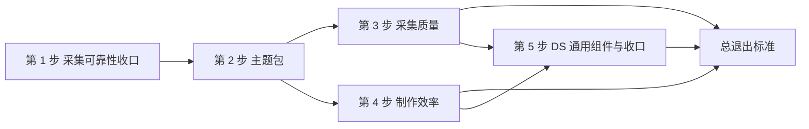

# PBWork 与 PB 平台升级

> 状态：执行中。第 1 步代码已实现、待验收；第 2 步已落地键目录、基础包与 Target 状态，尚未接入 Runtime。全部改动在分支 `dev-platform`，未合入 `main`。核实日期：2026-10-16。本文是计划，不代表现行 Contract。
>
> 实施设计见[原型主题包与授权设计](./prototype-theme-and-authoring-design.md)。「一刻」原型见[下一份计划](./yike-prototype.md)，以本计划的第 2、3、4、5 步交付的能力为前置条件。

## 为什么要做这件事

PBWork 现在能产出可采集的原型，但三处明显不足：

- **制作成本高。** 写一个原型要反复抄导航、存储、外壳和主题偏好；同一份 Token 要在 CSS 和 `data-pb-token-*` 里各写一遍；门禁要等整份 Preflight 才知道有没有问题。
- **采集在失败路径上不可信。** 截图写入失败时 Case 仍显示 captured；采集中途崩溃会丢掉已完成的 Case；确认面板上停留越久，每次对账都会启动一次 Chromium 并生成新的报告文件。
- **原型没有自己的品牌。** 只有全局的浅色与深色两套皮肤，所有原型都长得像 PBWork。字体、圆角、表面质感这些「性格」被写死在组件里，主题改不动。

这次升级要提升的是所有原型在**制作效率**与**采集质量**上的下限，不针对某一个原型。一刻是第一个验收样本，冷链是回归样本。

## 目标

1. **制作更快**：声明一次同时产出样式与证据；导航、存储、外壳、主题偏好由共享套件承担；门禁在保存时暴露问题，而不是等到整份 Preflight。
2. **采集更可靠**：失败路径如实进入 Evidence；崩溃可恢复；主题取值固定进 Evidence，键与值一一对应。
3. **原型有自己的品牌**：原型持有自己的主题包，一个包可以声明多套主题，每套含浅色与深色，运行时按偏好切换。

规范本身做减法。一个概念能覆盖的，不再引入两个；成本高、收益不普遍的能力，等出现第二个真实需求再做。

## 原则：Evidence 记键，主题包固定值

- **Case 记键名。** 每个证据节点的 `tokenBindings` 记录它绑定的 Token 键，不逐节点复制取值。
- **Handoff 固定取值表。** 交付时把该主题包、该主题、该模式下全部键的解析值固定进 Handoff，键与值一一对应。
- **端上命中键名。** PBWork 的 DS 与将来的其它端共用同一套键名；端上算出的值与 Evidence 固定的值不一致，说明主题包、映射或端实现有一环出了问题，按缺陷处理。Evidence 的值是兜底事实。
- **模式不进入 Case 矩阵。** 主题取值变化使 Evidence 过期（`inputVersion` 覆盖主题摘要），但不改变 Case 身份；浅色与深色的结构一致由主题一致性探针守住，而不是再采一遍 Case。

## 范围约束

- **字体移出范围。** 主题包不声明字体文件，不引入 FontFace、字体 Blob 与许可证校验；字族固定为系统字体栈，字阶角色与字重、字号、行高留在主题包内。字体问题一律不作为门禁项。
- **Flutter 与其它交付端移出本轮范围。** 本轮不改 `apps/flutter_pb_app`，不要求它命中新键名。验收范围为 PBWork 与 Core，`verify` 中的 Flutter 两步不计入退出标准；本机 Flutter 3.44 下的失败作为已知环境问题记录，不作为本计划的未完成项。Target 同步检查仍需通过，但只要求如实报告未命中项，不要求清零。
- **不兼容现有原型。** 旧样例原型（健身自律记录）已移除，不迁移。冷链原型保留为回归样本，并迁移到本计划的新写法；迁移中出现的报错按新规则修复，不为旧写法保留兼容层。
- **Core 仍是唯一语义层。** 主题包身份、主题一致性判定、`pending` 状态等新语义都由 Core 定义；PBWork、CLI、MCP 与 Local Service 只适配。
- **不做的事：** 组件层 Token 全量发布、多手机设备正式采集、Evidence Review 信息层级与窄屏、首次 setup、npm 分发、交付端适配（均在[未排期议题](./README.md#未排期议题)）。

## 进度

| 步骤 | 状态 | 证据 / 剩余缺口 |
| --- | --- | --- |
| 第 1 步 采集可靠性收口 | 代码已实现，待验收 | 旧样例原型与旧 Capture 死代码已清除（`docs/history` 之外全仓 `rg` 旧原型关键词无结果），本地 `capture.maxCases` 已改 200 并 `pnpm pb:reset`。8 项可靠性问题各有回归或故障注入用例：`packages/core/test/v2/capture/capture-reliability.test.ts`（必需 Blob、Issue 写入、崩溃恢复）、`packages/local-service/test/service-reliability.test.ts`（对账缓存、Delivery ID、Host 头）、`packages/core/test/v2/store/{atomic-file,delivery-id,service-launch}.test.ts`、`workspace-config.test.ts`、`local-service/test/launch-config.test.ts`；均验证过在旧实现上失败。当前通过：core 313、local-service 38、cli 20、pbwork 177 个单测；`test:e2e:runtime/mcp/consumer/evidence-slice/finalization/lifecycle` 通过。遗留：PBWork Playwright 6 个用例失败（`canvas`、`comments`、`design-system-closure`、`workbench-navigation`），在收敛前的 `main` HEAD 上同样失败，属原型目录重排后的过期断言；`verify` 的 Flutter 两步因环境失败，按「范围约束」不计入。 |
| 第 2 步 主题包 | 进行中 | Core 主题模块（`packages/core/src/v2/theme/`：schema、expression、resolve、contrast、digest、validate、index，已导出并加 `./v2/theme` 子路径）已交付，需按收敛后的范围复核。键目录与基础包（`design-system/theme/key-catalog.json`、`constants.json`、`legacy-migration.json`、`sources.ts`；`theme-packs/base/`）已落地但未接入 Runtime，待按收敛后的范围调整：删除字体声明与主题色轴，改为多套主题声明，组件层收缩为性格键，间距采用「键名不变、只改用途说明」的方案。Target 状态已完成：core target 测试 31 个通过、`ds:target-sync:verify` 通过、`test:e2e:mcp` 通过。未开始：Runtime 与 Vuetify 接入、DS 组件迁移、冷链等价迁移、样例主题包、Playground 对比、字体与主题色轴相关代码的删除。 |
| 第 3 步 采集质量 | 未开始 | 依赖第 2 步。含主题身份接入 Core、Handoff 固定取值表、MCP 读取、主题一致性探针、可声明时钟。 |
| 第 4 步 制作效率 | 未开始 | 依赖第 2 步的键名。含 `v-pb` 与 `pbStyle()`、键类型生成、就近声明与自动汇总、共享原型运行套件、脚手架、实时门禁。 |
| 第 5 步 DS 通用组件与收口 | 未开始 | 依赖第 4 步的写法与第 2 步的键名。组件清单见该步。 |



第 3 步与第 4 步都只依赖第 2 步，可以并行。第 5 步的组件要用第 4 步的新写法与第 2 步的键名，因此排在最后。

---

## 第 1 步 采集可靠性收口

让「Evidence 就是产品」在失败路径上也成立，并把暂停期间的遗留事项结清。

### 内容

1. 修复 PBWork 的 6 个过期断言：`canvas.spec` 的屏幕切换、`workbench-navigation` 的组件导航与折叠面板、`comments`、`design-system-closure` 两项。这些断言引用的原型目录在旧样例原型移除后已失效。
2. 结清上一轮已决但未执行的事项：
   - 同一 Issue ID 不同内容不再「首写保留」，改为按内容摘要分别存储、Revision 固定引用到具体摘要、同内容去重；若必须改公共 Schema，先确认再做。
   - `scripts/pb-clean.mjs` 改用 Core 统一的 Service 启动配置，不再自行读取 `service.port` 并写死 `127.0.0.1`。
   - 新增 ADR，记录采集可靠性设计（逐 Case staging 恢复、Workspace 单飞队列、Service 只从配置启动）。
   - 补 `packages/core/src/v2/prompts/` 三份提示模板的 Target `pending` 状态列表与 claim 路径的 `pending` 专项测试。
3. 记录已知未处理项，不阻塞本步：`activeJob` 去掉 composer 后无写入方；`archiveCurrentBundle`、`forkCurrentBundle`、`resetWorkspaceEvidence`、`trashBundles` 等 store 成员零调用方但保留；旧样例原型「进度刷新后保留」的 E2E 已删除且无等价替换。
4. 合入 `main`。合入前按工作流整理提交历史（两次交付的改动目前混在同一工作树）。

### 退出标准

- `pnpm docs:verify`、`pnpm build`、`pnpm typecheck`、core / local-service / cli / pbwork 单测、PBWork Playwright 全部通过；`test:e2e:runtime/mcp/consumer/evidence-slice/finalization/lifecycle` 通过。Flutter 两步不计入。
- 冷链通过 Workbench 完整定稿一次：Job 全部 captured，Handoff 与 Delivery 绑定，stage `final`。
- 改动合入 `main`。

---

## 第 2 步 主题包

键名归 PBWork，键值归主题包；一个原型可以有自己的一套或多套主题。实施细节见[设计稿第 2、3、5 节](./prototype-theme-and-authoring-design.md#2-键目录)。

### 内容

1. **键目录。** 在 `design-system/theme/` 维护键目录与常量表，每个键声明 `tier`（`semantic` / `component` / `constant`）、`valueType`、`bindable`、`modeVariant`。CSS 单位由 `valueType` 决定，不再由键前缀正则决定；常量不可被主题包覆盖，也不进入 Target 映射。
2. **键名按用途命名，间距保留刻度名。** 颜色、圆角、尺寸、描边、阴影、透明度、动效、表面、密度、资产按用途命名；**间距沿用现有刻度 ID，只更新用途说明、不改变数值，也不逐处判定用途**。理由：本轮交付端适配移出范围，逐处判定只能换来更细的语义标注，却要在 Web 约 500 处人工判断，性价比不足。刻度名（`xs`/`sm`/`md`…）继续对 Agent 与 Evidence 可见。
3. **删除字体相关能力。** 主题包不声明字体；字阶角色只声明字重、字号、行高，字族固定为系统字体栈。删除 Core 主题模块中的字体 schema、字体许可证与字体文件校验。删除 `font.*` 语义键。
4. **组件层收缩为性格键。** 不做每槽一个组件键的全量改写。组件层只保留两类：
   - 通用性格键：`density`、`motion.personality`、`surface.treatment`、`radius.control`、`radius.surface`，由全部 DS 组件消费；
   - 与旧键等价所必需的少量组件键，以及表面处理键（`primary-tabs.selection-treatment`、`tabbar.surface-treatment`、`app-bar.surface-treatment`）。
   其余 `tokenBindings` 槽继续直接绑定语义键。组件形态差异由原型自有组件与 DS 扩展承担，记为 DS 缺口（见 [ADR 0012](../decisions/0012-pbwork-ds-is-foundation-not-ceiling.md)）。
5. **一个包，多套主题。** 主题包声明一组主题，每套主题有自己的语义层取值与 `light` / `dark` 两种模式。原计划单独设计的「主题色轴」并入这个概念：只改颜色键的一套主题就是主题色轴。主题身份为 `packId@digest / theme / mode`，`mode` 取 `light`、`dark` 或跟随系统。
6. **校验器。** Core 定义规则，PBWork 与脚本调用：键名必须在键目录内、引用可解析、无循环引用、非 `modeVariant` 键不得随模式变化、每组前景/背景配对满足 WCAG AA（未声明的失败为 block，已声明理由的为 warning）、基础包必须为全部键给出取值。不允许新增 PBWork 未定义的键名。
7. **Runtime 与 Vuetify。** 按当前原型、当前主题与模式生成 CSS 变量与 Vuetify 主题；偏好按主题与模式分别保存。Workbench 自身主题仍是独立通道。
8. **DS 组件迁移。** DS 组件 CSS 与 `tokenBindings` 换成新键名；模块级 `tokenDefault*` 读取（约 40 处）改为响应式或常量。毛玻璃由一个共享的表面组件按 `surface.treatment` 驱动。
9. **冷链等价迁移。** 冷链三个 Screen 的 `var(--pb-*)` 与 `data-pb-token-*` 按映射表换成新键名，视觉与迁移前一致。
10. **Workbench 预览。** Token Gallery 与 Component Playground 可以选择主题包、主题与模式，用该包渲染全部 DS 组件，便于评审「这个原型像不像它自己」。

### 退出标准

- 冷链使用基础包，视觉与迁移前一致（迁移前后 default Variant 截图人工比对）。
- 样例主题包与基础包在配色、圆角、表面性格上明显不同，Playground 中并排对比能一眼看出差异；样例包至少有 `light` / `dark` 两种模式与一套额外主题。
- 校验器对缺键、循环引用、模式越权、对比度不足各有失败用例。
- `pnpm docs:verify`、`pnpm --filter pbwork test`、`pnpm --filter @proto-bridge/core test`、`pnpm typecheck` 通过；`ds:target-sync:verify` 通过并如实列出未命中项（不要求清零）。
- 旧键与新键目录的等价测试覆盖 154 个旧键的分层去向。

---

## 第 3 步 采集质量

主题取值固定进 Evidence，键与值一一对应；模式不重复采集但结构有保证；采集时间确定。实施细节见[设计稿第 4、6 节](./prototype-theme-and-authoring-design.md#4-主题身份接入-core)。

### 内容

1. **主题身份接入 Core。** 身份统一为 `ThemeIdentity { packId, packDigest, theme, mode }`。
   - Runtime 清单新增必填 `theme`（包 ID、digest、键目录 digest、主题列表、默认主题、模式列表、默认模式）；协议版本升级，破坏性变更由本计划承担，fixtures 与 e2e 一次性更新。
   - Case 的主题字段语义收窄为模式 ID；Selection 删除主题维度，矩阵展开时取默认模式与默认主题。
   - Case URL 写模式，不再写主题；Capture 的环境（`colorScheme`）从模式推导；actual 与 Selection 的主题摘要不一致即阻断。
   - `inputVersion` 加入主题包 digest 与键目录摘要，使主题取值或键目录变化时现有 Evidence 判定过期。
   - Catalog 新增 `theme-pack` 种类：包清单与每个「主题 × 模式」的解析值表；token Catalog 改为键目录（只含键定义与来源 Contract，不含取值）；常量不进入 Catalog。
   - Handoff 新增必填主题包字段；有 tokenBindings 事实时同时要求 token 与 theme-pack 两种 Catalog。
   - 读模型以 Case 的 `tokenBindings` 关联 Handoff 固定的取值表，派生每个绑定的解析值与引用链，输出 `resolvedValue`、`chain`、`tier`；不在 Case 里逐节点复制取值。
   - 删除 CLI 的主题参数；Snapshot 摘要打印主题身份。
2. **MCP 读取。** 新增读取主题包取值表的工具，只经 Handoff 的 Catalog 引用读取，不回退 active / latest；默认返回 Handoff 的默认主题与模式，请求非默认组合时返回该表并标注未采集。`read_screen_packet` 的 token 清单附解析值。同步 MCP README 与工具注册测试。
3. **主题一致性探针。** Preflight 时对每个 Screen 的 default Variant 在各主题与各模式下各渲染一次，比较语义树：节点 identity、`role`、可见性、bbox 是否非零、`componentId`、排序后的 `tokenBindings`、语义父节点；不比较坐标、尺寸、文本与取值。出现分叉即阻断为 Authoring Diagnostic，并报告 Screen、组合、节点与差异字段。结果不写 Evidence。随模式变化的资源走 `asset.*` 键，不在代码里按模式分支。
4. **可声明时钟。** 原型在 manifest 中声明固定的「现在」（时间与时区）；Capture 按声明安装时钟，替代写死的日期；共享 `useClock()` 在交互模式走真实时间，在采集模式走声明时间。时钟声明进入 `inputVersion`。
5. **测试。** 改主题取值后 Evidence 判定过期的回归；探针拦住「某个模式隐藏节点」的人为夹具；同一 Case 两次采集的时间相关文字与截图一致。

### 退出标准

- 冷链定稿生成的 Handoff 可通过 MCP 读到主题包 digest 与完整取值表（键与值一一对应）。
- 探针在注入分叉时阻断并指出节点；移除后通过；冷链所有 Screen 在 `light` / `dark` 下通过。
- 声明时钟的 Case 两次采集结果一致。
- `pnpm docs:verify`、core 与 mcp-server 单测、`test:e2e:runtime`、`test:e2e:mcp`、`test:e2e:evidence-slice`、`test:e2e:finalization`、`test:e2e:lifecycle` 通过。

---

## 第 4 步 制作效率

写一个原型的时间显著下降，门禁提前到保存时。键类型生成的细节见[设计稿第 7 节](./prototype-theme-and-authoring-design.md#7-pbstyle-键类型生成)。

### 内容

1. **一次声明，同时产出样式与证据。** 提供 `v-pb` 指令与 `pbStyle()`：

   ```vue
   <span
     v-pb="{ id: 'remaining', role: 'text', key: habit.id }"
     :style="pbStyle({ color: 'color.on-surface-muted', typography: 'typography.caption' })"
   >
     还差 2 次
   </span>
   ```

   一次声明生成 CSS 变量、`data-pb-id` / `role` / `key` 与 `data-pb-token-*`。键名类型由脚本从键目录与 Contract 生成（提交入库，含新鲜度测试），只接受已注册的键，未知键在类型检查阶段被拒绝。DS 组件实例继续由 Registry 提供绑定。
2. **就近声明并自动汇总。** 每个 Screen 目录放声明文件，用 `defineScreen()` 与片段助手自动补全 Screen 身份与 pbId 前缀；总登记表改为 glob 汇总。标为必需的节点在构建时生成 default Variant 的完整性边界，生成文件提交入库以便审阅 diff——这仍是作者显式声明的边界。
3. **共享原型运行套件。** 提供带 schema 版本的本地存储、进入 / 返回 / 替换导航（保留父级引用）、主题与模式偏好同步、Tab 外壳、启动页插槽、可声明时钟。原型只写业务模型与页面。
4. **脚手架。** `pnpm pb:new-prototype <id>` 生成目录结构、主题包模板、`docs/design.md` 模板（`status: draft`）、外壳、一个示例 Screen 与测试。
5. **实时门禁。** 在现有 Authoring Diagnostics 与 Inspector 基础上，Workbench 按当前 Screen 实时显示缺节点、缺 role、缺 Token Evidence、零 bbox、遮挡等问题。实施前先确认现有诊断的覆盖范围，只补缺口。

### 退出标准

- 冷链三个 Screen 迁移到新写法，记录迁移前后的 Screen 代码、CSS 与登记表行数。
- 脚手架生成的空原型无需手改即可通过 Preflight 并完成一次定稿。
- 声明时钟后，同一 Case 两次采集的时间相关文字与截图一致。
- `pnpm docs:verify`、PBWork 单测与 build、`test:e2e:runtime` 通过。

---

## 第 5 步 DS 通用组件与收口

补上多数 App 都会用到的组件，并把文档、Skill 与 ADR 收口。

### 组件清单

按通用 App 的需要规划，不以某个实验原型是否做过为依据。每个组件都要有 Contract、Registry、Playground、单测，遵守 Flex-only 与只用 Token 的红线，使用第 4 步的写法与第 2 步的键名。

| 类别 | 组件 |
| --- | --- |
| 输入 | SegmentedControl、Stepper、DurationPicker（滚轮） |
| 展示 | RingProgress（确定进度环）、Metric（数字加单位加变化量）、Tag、MiniBars、Heatmap、MonthCalendar |
| 列表 | GroupedList、ListCell（前置图标、主副标题、尾部值、开关或箭头） |
| 反馈 | 带撤销动作的 Snackbar、带档位的 Sheet、ActionSheet |
| 导航与品牌 | LaunchScreen 模式、BrandMark 插槽 |

其余候选（Slider、TimePicker、SwipeActions、LargeTitleHeader、Timeline、DatePicker、ColorSwatchPicker、Banner、完成反馈层、PageIndicator）在原型制作中按 Promotion Mapping 按需进入 DS。

### Target 的 `pending` 状态

- 目标清单支持为组件或 Token 显式声明 `status: "pending"`。
- 同步检查报告 pending 数量与清单，不因 pending 判失败；未声明又缺失的项仍判失败。
- MCP 的 Target 解析工具对 pending 项如实返回「待实现」，不猜测替代组件。
- pending 语义由 Core 定义（第 2 步已交付）。

### 文档、Skill 与 ADR 收口

随各步同步，不集中到最后：

- `AGENTS.md` 红线：「具体值只存在于 Foundation/Theme」改为「具体值只存在于主题包或 PBWork 常量表」；补充「原型可以有自有组件与自有主题包」的表述（与 ADR 0012 一致）。
- 语义标记与证据门禁、原型 Authoring Contract、PBWork Skill 的 references、`apps/pbwork/docs/checklist.md`、Token 与 Theme 手册、组件总论。
- Evidence 模型与采集链路：主题身份、键值对应、时钟声明、逐 Case staging 与崩溃恢复。
- 配置参考与本地操作脚本：`pb:up` 配置来源、`pb:new-prototype`。
- ADR：三层 Token 与原型主题包；以主题一致性探针替代多主题采集；采集可靠性设计。ADR 0012 已确立「DS 是基础而不是上限」，第 2 步交付后把其中的品牌层缺口改为由原型主题包承接。

### 退出标准

- 清单内全部组件在 Playground 中可用基础包与样例主题包分别渲染，覆盖浅色与深色。
- `pnpm docs:verify`、`pnpm typecheck`、PBWork 单测与 build、`ds:target-sync:verify` 通过，pending 清单如实列出。

---

## 总退出标准

- `pnpm docs:verify`、`pnpm typecheck`、`pnpm ds:target-sync:verify` 通过；Flutter 两步不计入（见「范围约束」）；pending 项如实列出。
- Core、Local Service、CLI、PBWork 单测与 PBWork Playwright 全部通过；`test:e2e:runtime/mcp/consumer/evidence-slice/finalization/lifecycle` 通过。
- 冷链按新写法完整定稿采集一次：Job 全部 captured，Handoff 与 Delivery 绑定，stage `final`，且可通过 MCP 读到主题包取值表与时钟声明。
- 基础包之外的样例主题包在 Playground 中能明显看出差异。
- 脚手架生成的空原型可直接通过 Preflight。
- 仓库（`docs/history` 除外）不再引用旧样例原型。

## 风险与缩减顺序

- 第 2 步触及 Token Schema、全部 DS 组件的取值方式、Vuetify 主题、快照比对与 MCP，成本最高。收敛后已削减字体、主题色轴与组件层全量迁移，剩余成本集中在 DS 组件迁移（约 1788 处 `var(--pb-*)` 消费）与冷链等价迁移。若仍明显超出预期，先暂停并与用户确认。
- 交付压力下的缩减顺序：先砍第 5 步的 Stepper、MiniBars、ActionSheet；再把第 4 步的实时门禁与脚手架推迟；第 1、2、3 步不缩减，它们是一刻的前置能力。
- 第 4 步的键类型生成依赖第 2 步的键目录。若第 2 步的键名还要调整，先改键目录再生成类型，避免二次迁移。
- 基础包的 6 个不达标配对沿用豁免（带理由，报 warning），修色作为第 2 步之后的独立任务，不与等价迁移混做，以免破坏「迁移前后截图一致」的可判定性。

## 历史与来源

- 暂停记录（2026-10-16）已并入第 1、2 步的内容与遗留项，不再单列。
- 本计划在 2026-10-16 收敛过一次：先前按工作流与切片编号组织的范围合并为五步，字体、交付端适配与组件层全量发布移出范围，「主题色轴」并入「一个包多套主题」，间距采用「键名不变、只改用途说明」。收敛前的实施设计已重写为本计划附属的[原型主题包与授权设计](./prototype-theme-and-authoring-design.md)。
