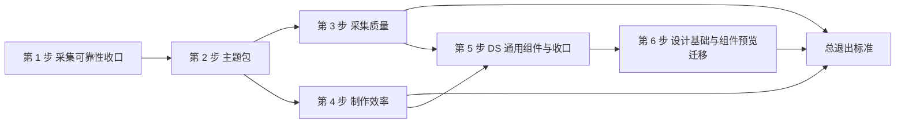

# PBWork 与 PB 平台升级

> 状态：执行中。第 1–6 步各自的退出标准均已满足，均未合入 `main`。第 6 步设计基础与组件预览迁移于 2026-10-18 完成：6A–6D 已交付，来源与组件品质修复已确认，6E 验收通过；展示草稿按用户决定保留。总退出标准尚未作为一批重跑。代码位于 `dev-platform`。合入 `main` 仍需另行授权。核实日期：2026-10-18。本文是计划，不代表现行 Contract。
>
> 实施设计见[原型主题包与授权设计](./prototype-theme-and-authoring-design.md)。「一刻」原型见[下一份计划](./yike-prototype.md)，以本计划第 2–5 步的能力及第 6 步预览迁移完成为前置条件；一刻正式制作留给后续独立对话。

## 为什么要做这件事

PBWork 现在能产出可采集的原型，但三处明显不足：

- **制作成本高。** 写一个原型要反复抄导航、存储、外壳和主题偏好；同一份 Token 要在 CSS 和 `data-pb-token-*` 里各写一遍；门禁要等整份 Preflight 才知道有没有问题。
- **采集在失败路径上不可信。** 截图写入失败时 Case 仍显示 captured；采集中途崩溃会丢掉已完成的 Case；确认面板上停留越久，每次对账都会启动一次 Chromium 并生成新的报告文件。
- **原型没有自己的品牌。** 只有全局的浅色与深色两套皮肤，所有原型都长得像 PBWork。字体、圆角、表面质感这些「性格」被写死在组件里，主题改不动。

这次升级要提升的是所有原型在**制作效率**与**采集质量**上的下限，不针对某一个原型。一刻是第一个验收样本，冷链是回归样本。

## 目标

1. **制作更快**：声明一次同时产出样式与证据；导航、存储、外壳、主题偏好由共享套件承担；门禁在保存时暴露问题，而不是等到整份 Preflight。
2. **采集更可靠**：失败路径如实进入 Evidence；崩溃可恢复；主题取值固定进 Evidence，键与值一一对应。
3. **原型有自己的品牌**：原型持有自己的主题包，一个包可以声明多套主题，每套含浅色与深色，运行时按偏好切换。

规范本身做减法。一个概念能覆盖的，不再引入两个；成本高、收益不普遍的能力，等出现第二个真实需求再做。

## 原则：Evidence 记键，主题包固定值

- **Case 记键名。** 每个证据节点的 `tokenBindings` 记录它绑定的 Token 键，不逐节点复制取值。
- **Handoff 固定取值表。** 交付时把该主题包、该主题、该模式下全部键的解析值固定进 Handoff，键与值一一对应。
- **端上命中键名。** PBWork 的 DS 与将来的其它端共用同一套键名；端上算出的值与 Evidence 固定的值不一致，说明主题包、映射或端实现有一环出了问题，按缺陷处理。Evidence 的值是兜底事实。
- **模式不进入 Case 矩阵。** 主题取值变化使 Evidence 过期（`inputVersion` 覆盖主题摘要），但不改变 Case 身份；浅色与深色的结构一致由主题一致性探针守住，而不是再采一遍 Case。

## 范围约束

- **字体移出范围。** 主题包不声明字体文件，不引入 FontFace、字体 Blob 与许可证校验；字族固定为系统字体栈，字阶角色与字重、字号、行高留在主题包内。字体问题一律不作为门禁项。
- **Flutter 与其它交付端移出本轮范围。** 本轮不改 `apps/flutter_pb_app`，不要求它命中新键名。验收范围为 PBWork 与 Core，`verify` 中的 Flutter 两步不计入退出标准；本机 Flutter 3.44 下的失败作为已知环境问题记录，不作为本计划的未完成项。Target 同步检查仍需通过，但只要求如实报告未命中项，不要求清零。
- **不兼容现有原型。** 旧样例原型已移除，不迁移。冷链原型保留为回归样本，并迁移到本计划的新写法；迁移中出现的报错按新规则修复，不为旧写法保留兼容层。
- **Core 仍是唯一语义层。** 主题包身份、主题一致性判定、`pending` 状态等新语义都由 Core 定义；PBWork、CLI、MCP 与 Local Service 只适配。
- **不做的事：** 组件层 Token 全量发布、多手机设备正式采集、Evidence Review 信息层级与窄屏、首次 setup、npm 分发、交付端适配（均在[未排期议题](./README.md#未排期议题)）。

## 进度

| 步骤 | 状态 | 证据 / 剩余缺口 |
| --- | --- | --- |
| 第 1 步 采集可靠性收口 | 实现与验收已完成（未合入 main） | 2026-10-16 收尾：Issue 按内容摘要存储并固定 Fact 引用（不改公共 Schema 字段）、`pb:clean` 共用 Core 启动配置、三份提示模板与 pending claim 专项测试、[ADR 0013](../decisions/0013-capture-reliability.md)。修复 6 个过期断言，并修复 Runtime 返回退出工作台的缺陷、生命周期 E2E 共享 sidecar 与漏 mock Job 的问题、主题包定义被旧颜色门禁误报的问题。验证：build/typecheck、core 435、local-service 39、cli 20、pbwork 198 个单测通过（另 11 个主题迁移 todo 保留给第 2 步）；PBWork Playwright 41 个用例均已有通过记录（最后全量 40 通过，唯一失败的 lifecycle-persistence 修复后单独通过）；runtime/mcp/consumer/evidence-slice/finalization/lifecycle 均覆盖通过。冷链真实定稿与固定引用见下方验收记录。 |
| 第 2 步 主题包 | 实现与退出标准已满足（未合入 main） | 2026-10-16：用户确认冷链三个 default 屏与迁移前没有视觉差别。验证：`pnpm docs:verify`；PBWork `vitest run` 223 项；Core `vitest run` 433 项；`pnpm typecheck`（Core、Local Service、CLI、MCP）；`pnpm ds:target-sync:verify` 通过，32/32 组件与 127/127 可绑定键已列入映射，159 项 Flutter 适配保持 pending。样例包与 Gallery/Playground 选择器已落地。取值表的采集固定见第 3 步。 |
| 第 3 步 采集质量 | 实现与退出标准已满足（未合入 main） | 2026-10-17：协议 3。Case 身份只保留模式，Selection/Handoff 固定主题包，取值表进 theme-pack Catalog。冷链定稿 Handoff 经 MCP `read_theme_pack` 读到 `pbwork-base` 摘要和完整取值表，深色组合标注未采集。探针在预检中打开每个主题与模式；隐藏节点的夹具会阻断。声明时钟两次读取一致。验证：`pnpm docs:verify`；Core `vitest run` 437 项；`test:e2e:runtime` 8 项、`test:e2e:mcp`、`test:e2e:evidence-slice`、`test:e2e:finalization` 3 项、`test:e2e:lifecycle`；`pnpm ds:target-sync:verify` 通过，159 项 Flutter 适配保持 pending。 |
| 第 4 步 制作效率 | 实现与退出标准已满足（未提交、未合入 main） | 2026-10-17：`v-pb` / `pbStyle()`、生成键类型与显式 default 边界、Screen 就近声明 / glob 汇总、共享运行套件、脚手架与当前 Screen 实时诊断均已落地。冷链三屏默认截图迁移前后字节一致；原样脚手架通过 Preflight、同 Case 双采集及 Workbench 定稿。PBWork 236 项单测、build、Runtime 9 项、`docs:verify`、`ds:target-sync:verify` 通过；159 项 Flutter pending 保持。见本步验收记录。 |
| 第 5 步 DS 通用组件与收口 | 实现与退出标准已满足（未合入 main） | 2026-10-17：清单内 15 个通用组件与带档位的 BottomSheet 已进入 Contract、Registry、Playground 与手册。基础包与样例包的浅色、深色均可渲染。`pnpm docs:verify`、`pnpm typecheck`、PBWork 326 项单测与 build、`ds:target-sync:verify` 通过；47/47 组件与 130/130 可绑定键已映射，177 项 Flutter 适配保持 pending。见本步验收记录。 |

| 第 6 步 设计基础与组件预览迁移 | 已完成（未合入 main） | 2026-10-18：12 个设计基础分类、主题页与 Registry 47 个组件均在共享手机内；来源矩阵与组件品质修复经用户确认完成；展示草稿保留。验证见本步 6E 记录。不制作 yike。 |



第 3 步与第 4 步都只依赖第 2 步，可以并行。第 5 步的组件要用第 4 步的新写法与第 2 步的键名，因此排在第 3、4 步之后；第 6 步接续已有能力完成预览迁移，之后再制作一刻。

---

## 第 1 步 采集可靠性收口

让「Evidence 就是产品」在失败路径上也成立，并把暂停期间的遗留事项结清。

### 内容

1. 修复 PBWork 的 6 个过期断言：`canvas.spec` 的屏幕切换、`workbench-navigation` 的组件导航与折叠面板、`comments`、`design-system-closure` 两项。这些断言引用的原型目录在旧样例原型移除后已失效。
2. 结清上一轮已决但未执行的事项：
   - 同一 Issue ID 不同内容不再「首写保留」，改为按内容摘要分别存储、Revision 固定引用到具体摘要、同内容去重；若必须改公共 Schema，先确认再做。
   - `scripts/pb-clean.mjs` 改用 Core 统一的 Service 启动配置，不再自行读取 `service.port` 并写死 `127.0.0.1`。
   - 新增 ADR，记录采集可靠性设计（逐 Case staging 恢复、Workspace 单飞队列、Service 只从配置启动）。
   - 补 `packages/core/src/v2/prompts/` 三份提示模板的 Target `pending` 状态列表与 claim 路径的 `pending` 专项测试。
3. 记录已知未处理项，不阻塞本步：`activeJob` 去掉 composer 后无写入方；`archiveCurrentBundle`、`forkCurrentBundle`、`resetWorkspaceEvidence`、`trashBundles` 等 store 成员零调用方但保留；旧样例原型「进度刷新后保留」的 E2E 已删除且无等价替换。
4. 改动保留在工作区；只有用户明确授权后才整理提交并合入 `main`。

### 退出标准

- `pnpm docs:verify`、`pnpm build`、`pnpm typecheck`、core / local-service / cli / pbwork 单测、PBWork Playwright 全部通过；`test:e2e:runtime/mcp/consumer/evidence-slice/finalization/lifecycle` 通过。Flutter 两步不计入。
- 冷链通过 Workbench 完整定稿一次：Job 全部 captured，Handoff 与 Delivery 绑定，stage `final`。
- Git 提交与合入 `main` 由用户另行明确授权；当前不执行，也不阻塞继续第 2 步。

### 本次验收记录（2026-10-16）

- 在隔离的 Playwright Workspace 经 Workbench 完整定稿，未改动日常 Workspace 的 Evidence。Job `job-2026-10-16t123812711-541f5889`：26/26 captured，其余计数为 0；生命周期 `stage: final`。
- Bundle `bundle-2026-10-16t123812710-1158cdfb`、Snapshot `snapshot-2026-10-16t123833968-e4a94eac`、Handoff `handoff-2026-10-16t123837959-9e4644f6`、Delivery `operation-e0950f0f178da732583b4a02` 精确绑定；Core 只读 Store 检查通过。
- 使用现有 `test-evidence-vertical-slice.mjs` 的 MCP 断言段复查上述同一组产物，跳过重复 build 与重复浏览器采集：固定 Snapshot、Screen Packet 与 Screenshot ImageContent 均通过。
- 验证入口：`pnpm build`；Core/Local Service/CLI/PBWork 的 `vitest run`；`pnpm --filter @proto-bridge/pbwork exec playwright test --workers=2`；`node scripts/test-mcp-evidence.mjs`；`node scripts/test-consumer.mjs`；`node scripts/verify-ds-target-sync.mjs`；`pnpm docs:verify`。类型检查覆盖 Core、Local Service、CLI、MCP 与 PBWork。Flutter 按范围约束跳过。
- 已知不阻塞项保持不变：Capture Store 的 `activeJob` 无新的创建写入方；`archiveCurrentBundle`、`forkCurrentBundle`、`resetWorkspaceEvidence`、`trashBundles` 暂留；旧样例的进度持久化 E2E 无等价替换。本轮不清理这些成员。

---

## 第 2 步 主题包

键名归 PBWork，键值归主题包；一个原型可以有自己的一套或多套主题。实施细节见[设计稿第 2、3、5 节](./prototype-theme-and-authoring-design.md#2-键目录)。

### 内容

1. **键目录。** 在 `design-system/theme/` 维护键目录与常量表，每个键声明 `tier`（`semantic` / `component` / `constant`）、`valueType`、`bindable`、`modeVariant`。CSS 单位由 `valueType` 决定，不再由键前缀正则决定；常量不可被主题包覆盖，也不进入 Target 映射。
2. **键名按用途命名，间距保留刻度名。** 颜色、圆角、尺寸、描边、阴影、透明度、动效、表面、密度、资产按用途命名；**间距沿用现有刻度 ID，只更新用途说明、不改变数值，也不逐处判定用途**。理由：本轮交付端适配移出范围，逐处判定只能换来更细的语义标注，却要在 Web 约 500 处人工判断，性价比不足。刻度名（`xs`/`sm`/`md`…）继续对 Agent 与 Evidence 可见。
3. **删除字体相关能力。** 主题包不声明字体；字阶角色只声明字重、字号、行高，字族固定为系统字体栈。删除 Core 主题模块中的字体 schema、字体许可证与字体文件校验。删除 `font.*` 语义键。
4. **组件层收缩为性格键。** 不做每槽一个组件键的全量改写。组件层只保留两类：
   - 通用性格键：`density`、`motion.personality`、`surface.treatment`、`radius.control`、`radius.surface`，由全部 DS 组件消费；
   - 与旧键等价所必需的少量组件键，以及表面处理键（`primary-tabs.selection-treatment`、`tabbar.surface-treatment`、`app-bar.surface-treatment`）。
   其余 `tokenBindings` 槽继续直接绑定语义键。组件形态差异由原型自有组件与 DS 扩展承担，记为 DS 缺口（见 [ADR 0012](../decisions/0012-pbwork-ds-is-foundation-not-ceiling.md)）。
5. **一个包，多套主题。** 主题包声明一组主题，每套主题有自己的语义层取值与 `light` / `dark` 两种模式。原计划单独设计的「主题色轴」并入这个概念：只改颜色键的一套主题就是主题色轴。主题身份为 `packId@digest / theme / mode`，`mode` 取 `light`、`dark` 或跟随系统。
6. **校验器。** Core 定义规则，PBWork 与脚本调用：键名必须在键目录内、引用可解析、无循环引用、非 `modeVariant` 键不得随模式变化、每组前景/背景配对满足 WCAG AA（未声明的失败为 block，已声明理由的为 warning）、基础包必须为全部键给出取值。不允许新增 PBWork 未定义的键名。
7. **Runtime 与 Vuetify。** 按当前原型、当前主题与模式生成 CSS 变量与 Vuetify 主题；偏好按主题与模式分别保存。Workbench 自身主题仍是独立通道。
8. **DS 组件迁移。** DS 组件 CSS 与 `tokenBindings` 换成新键名；模块级 `tokenDefault*` 读取（约 40 处）改为响应式或常量。毛玻璃由一个共享的表面组件按 `surface.treatment` 驱动。
9. **冷链等价迁移。** 冷链三个 Screen 的 `var(--pb-*)` 与 `data-pb-token-*` 按映射表换成新键名，视觉与迁移前一致。
10. **Workbench 预览。** Token Gallery 与 Component Playground 可以选择主题包、主题与模式，用该包渲染全部 DS 组件，便于评审「这个原型像不像它自己」。

### 第 2 步第一批进度（2026-10-16）

- 主题解析底层与基础数据已收敛，CSS 生成器已提供；Runtime、Capture 和 Handoff 尚未改用新模型。没有修改 Flutter 代码。本批按用户授权提交一次，未合并 main；后续改动保留在工作区。
- 验证通过：`pnpm --filter @proto-bridge/core exec vitest run test/v2/theme`（110 项）；`pnpm --filter @proto-bridge/pbwork exec vitest run test/theme-base-pack.test.ts test/theme-equivalence.test.ts test/theme-css-vars.test.ts`（25 项，另 11 项组件迁移 todo）；Core `tsc -p tsconfig.json` 与 PBWork `vue-tsc -p tsconfig.json --noEmit`；`pnpm docs:verify`；`node scripts/verify-ds-target-sync.mjs`。Target 检查仍针对当前可见 Runtime 的 154 个旧键，新键接入时再更新 Target 状态。没有重跑第 1 步已通过的浏览器与全链路验收。
- 下一批接入 Runtime/Vuetify 前，先固定冷链 default Variant 的迁移前截图；再按少量组件键与现有映射表完成 DS/冷链迁移，保留 6 条基础配对豁免，不混入修色。

### 第 2 步第二批进度（2026-10-16，已完成）

- 本次按用户授权完成一次 Git 提交 `8b3b325`，未合入 main。其后的第二批改动只保留在工作区。
- 已接通主题包/原型包 glob 加载、原始资产字节摘要与构建 URL、Registry 的 Core 包/作用域校验。原型改为 themePackId，冷链绑定 pbwork-base。
- Runtime 已使用解析缓存、响应式主题表与 CSS；provide ThemeTableKey，支持 useToken/useTokenNumber。Vuetify 按身份动态注册并局部选择，表单密度来自当前表；Workbench 外壳主题保持独立。
- Runtime/画布使用原型隔离的 v2 主题/模式偏好。主题、浅色/深色/跟随系统分别选择；系统变化写具体 mode，保留 system 偏好。返回盖章、强制导航与 history state 已接线。URL 使用 theme（包内主题）与 mode（具体模式）。Case 身份、取值表与声明时钟的采集规则在第 3 步落地，现行说明见[主题包解析模型](../architecture/theme-packs.md#原型绑定与-capture-边界)。
- 过渡边界：第三批迁移前，Runtime 暂保留原有组件 CSS 生成结果，再叠加新键目录变量；没有新增新旧键别名。组件 JS 模块级默认值、Contract/Evidence 键绑定与旧文件删除仍属第三批；Gallery/Playground 静态双主题与样例包属第四批。因此第二批接入已完成，不代表整个第 2 步完成。三个 default Screen 的迁移前截图已保存于 `/tmp/pbwork-theme-migration/before-*.png`。
- 必要验证：PBWork 51 项相关单测、Core URL/协议 7 项通过；Runtime/画布 12 项浏览器检查通过，Manifest describe 与真实 Core Case Capture 各 1 项通过。Capture 专项发现内部 bridge 的 themeName 泄漏到严格响应，修复后只重跑该失败用例并通过。构建、PBWork 类型、文档与 Target 同步检查通过；Target 检查仍如实针对迁移前的 154 个 Catalog 键。未重复第 1 步全链路验收。

### 第 2 步第三、四批进度（2026-10-16）

- DS 与冷链已改用新键和响应式读取；旧生产 Token 文件已删除，154 个旧键的等价断言已落地。Runtime 只生成新表变量。
- 工作台草稿画布不再引用已删除的 `spacing.none`。一刻草稿壳层和组件 Playground 中失效的圆角、尺寸、间距变量已改到现行键；草稿里的三套表盘样式本身不走主题包。
- `pbwork-sample` 为 Playground 范围，继承基础包，含园色与柑色、浅色与深色。它改变品牌色、圆角、`density: compact`、`surface.treatment: glass`、`motion.personality: lively` 和 `asset.brand-mark`。正式原型不能绑定它。
- Gallery 与 Playground 可选择包、主题和模式，并对照另一包的解析值。主题页增加样例包性格对照。用户于 2026-10-16 确认冷链三个 default 屏与迁移前没有视觉差别。同日退出检查通过，见进度表。

### 退出标准

- 冷链使用基础包，视觉与迁移前一致（迁移前后 default Variant 截图人工比对）。
- 样例主题包与基础包在配色、圆角、表面性格上明显不同，Playground 中并排对比能一眼看出差异；样例包至少有 `light` / `dark` 两种模式与一套额外主题。
- 校验器对缺键、循环引用、模式越权、对比度不足各有失败用例。
- `pnpm docs:verify`、`pnpm --filter pbwork test`、`pnpm --filter @proto-bridge/core test`、`pnpm typecheck` 通过；`ds:target-sync:verify` 通过并如实列出未命中项（不要求清零）。
- 旧键与新键目录的等价测试覆盖 154 个旧键的分层去向。

---

## 第 3 步 采集质量

主题取值固定进 Evidence，键与值一一对应；模式不重复采集但结构有保证；采集时间确定。实施细节见[设计稿第 4、6 节](./prototype-theme-and-authoring-design.md#4-主题身份接入-core)。

### 内容

1. **主题身份接入 Core。** 身份统一为 `ThemeIdentity { packId, packDigest, theme, mode }`。
   - Runtime 清单新增必填 `theme`（包 ID、digest、键目录 digest、主题列表、默认主题、模式列表、默认模式）；协议版本升级，破坏性变更由本计划承担，fixtures 与 e2e 一次性更新。
   - Case 的主题字段语义收窄为模式 ID；Selection 删除主题维度，矩阵展开时取默认模式与默认主题。
   - Case URL 写模式，不再写主题；Capture 的环境（`colorScheme`）从模式推导；actual 与 Selection 的主题摘要不一致即阻断。
   - `inputVersion` 加入主题包 digest 与键目录摘要，使主题取值或键目录变化时现有 Evidence 判定过期。
   - Catalog 新增 `theme-pack` 种类：包清单与每个「主题 × 模式」的解析值表；token Catalog 改为键目录（只含键定义与来源 Contract，不含取值）；常量不进入 Catalog。
   - Handoff 新增必填主题包字段；有 tokenBindings 事实时同时要求 token 与 theme-pack 两种 Catalog。
   - 读模型以 Case 的 `tokenBindings` 关联 Handoff 固定的取值表，派生每个绑定的解析值与引用链，输出 `resolvedValue`、`chain`、`tier`；不在 Case 里逐节点复制取值。
   - 删除 CLI 的主题参数；Snapshot 摘要打印主题身份。
2. **MCP 读取。** 新增读取主题包取值表的工具，只经 Handoff 的 Catalog 引用读取，不回退 active / latest；默认返回 Handoff 的默认主题与模式，请求非默认组合时返回该表并标注未采集。`read_screen_packet` 的 token 清单附解析值。同步 MCP README 与工具注册测试。
3. **主题一致性探针。** Preflight 时对每个 Screen 的 default Variant 在各主题与各模式下各渲染一次，比较语义树：节点 identity、`role`、可见性、bbox 是否非零、`componentId`、排序后的 `tokenBindings`、语义父节点；不比较坐标、尺寸、文本与取值。出现分叉即阻断为 Authoring Diagnostic，并报告 Screen、组合、节点与差异字段。结果不写 Evidence。随模式变化的资源走 `asset.*` 键，不在代码里按模式分支。
4. **可声明时钟。** 原型在 manifest 中声明固定的「现在」（时间与时区）；Capture 按声明安装时钟，替代写死的日期；共享 `useClock()` 在交互模式走真实时间，在采集模式走声明时间。时钟声明进入 `inputVersion`。
5. **测试。** 改主题取值后 Evidence 判定过期的回归；探针拦住「某个模式隐藏节点」的人为夹具；同一 Case 两次采集的时间相关文字与截图一致。

### 退出标准

- 冷链定稿生成的 Handoff 可通过 MCP 读到主题包 digest 与完整取值表（键与值一一对应）。
- 探针在注入分叉时阻断并指出节点；移除后通过；冷链所有 Screen 在 `light` / `dark` 下通过。
- 声明时钟的 Case 两次采集结果一致。
- `pnpm docs:verify`、core 与 mcp-server 单测、`test:e2e:runtime`、`test:e2e:mcp`、`test:e2e:evidence-slice`、`test:e2e:finalization`、`test:e2e:lifecycle` 通过。

---

## 第 4 步 制作效率

写一个原型的时间显著下降，门禁提前到保存时。键类型生成的细节见[设计稿第 7 节](./prototype-theme-and-authoring-design.md#7-pbstyle-键类型生成)。

### 内容

1. **一次声明，同时产出样式与证据。** 提供 `v-pb` 指令与 `pbStyle()`：

   ```vue
   <span
     v-pb="{ id: 'remaining', role: 'text', key: habit.id }"
     :style="pbStyle({ color: 'color.on-surface-muted', typography: 'typography.caption' })"
   >
     还差 2 次
   </span>
   ```

   一次声明生成 CSS 变量、`data-pb-id` / `role` / `key` 与 `data-pb-token-*`。键名类型由脚本从键目录与 Contract 生成（提交入库，含新鲜度测试），只接受已注册的键，未知键在类型检查阶段被拒绝。DS 组件实例继续由 Registry 提供绑定。
2. **就近声明并自动汇总。** 每个 Screen 目录放声明文件，用 `defineScreen()` 与片段助手自动补全 Screen 身份与 pbId 前缀；总登记表改为 glob 汇总。标为必需的节点在构建时生成 default Variant 的完整性边界，生成文件提交入库以便审阅 diff——这仍是作者显式声明的边界。
3. **共享原型运行套件。** 提供带 schema 版本的本地存储、进入 / 返回 / 替换导航（保留父级引用）、主题与模式偏好同步、Tab 外壳、启动页插槽、可声明时钟。原型只写业务模型与页面。
4. **脚手架。** `pnpm pb:new-prototype <id>` 生成目录结构、主题包模板、`docs/design.md` 模板（`status: draft`）、外壳、一个示例 Screen 与测试。
5. **实时门禁。** 在现有 Authoring Diagnostics 与 Inspector 基础上，Workbench 按当前 Screen 实时显示缺节点、缺 role、缺 Token Evidence、零 bbox、遮挡等问题。实施前先确认现有诊断的覆盖范围，只补缺口。

### 退出标准

- 冷链三个 Screen 迁移到新写法，记录迁移前后的 Screen 代码、CSS 与登记表行数。
- 脚手架生成的空原型无需手改即可通过 Preflight 并完成一次定稿。
- 声明时钟后，同一 Case 两次采集的时间相关文字与截图一致。
- `pnpm docs:verify`、PBWork 单测与 build、`test:e2e:runtime` 通过。


### 本步验收记录（2026-10-17）

- `pnpm ds:keys:generate` 从键目录、常量表和 Contract 生成 `theme/generated/keys.ts`；新鲜度单测通过。`v-pb` 的 Vue 类型探针写入未知颜色键时，`vue-tsc` 明确拒绝。`pbStyle` 与 Inspector 共用槽字典，DS 实例与显式归属的 tab/panel 部件仍由 Registry 提供绑定，局部子节点不能借祖先绑定通过完整性检查。
- 三个 Screen 的声明移至各自 `screens/{slug}/screen.ts`，用 `defineScreen`、`fragment` 和 `screenScope` 缩短身份声明。总登记表 glob 汇总，并沿原型已有 screenGroups 保持顺序；default 边界由作者的 `required: true` 生成到 `prototypes/generated/default-boundaries.json`（66 行），有新鲜度测试。两种生成文件都留在工作区，待用户授权后纳入 Git 提交。
- 共享套件包含 schema 版本存储、显式迁移、父路径链、进入/返回/替换/Tab 导航、主题/模式偏好 API、Tab 组合壳和启动页插槽。时钟直接复用第 3 步的 `useClock()` 与既有 Capture 时钟，没有第二套时钟或新的时钟协议。
- 现有覆盖先核对：Runtime 已做必需片段缺失/重复、role、可见性/零 bbox 和遮挡检查；Inspector 已有选中元素的启发式提示。本步抽取复用检查并接入当前 Screen 的实时展示，补空 Token Evidence 检查。浏览器测试覆盖编辑后缺 role、缺 Token Evidence、零 bbox、遮挡与缺节点的实时更新，不需要先选中元素。

#### 冷链迁移行数

Screen 代码按 SFC 的 script + template（不含 style）计，CSS 按 scoped style 内容计；保留空行，按当前格式化结果统计。就近声明单列，生成边界不计入手写登记代码。

| Screen | Screen 代码：前 → 后 | CSS：前 → 后 | 就近声明：后 |
| --- | --- | --- | --- |
| exception-queue | 409 → 464 | 161 → 152 | 136 |
| shipment-detail | 405 → 461 | 248 → 241 | 105 |
| resolution-form | 446 → 544 | 86 → 67 | 129 |

原单体登记表为 688 行；迁移后 glob 汇总为 40 行，三个就近声明合计 370 行，原型元信息另放 `prototype.ts`。Screen 局部行数因类型化声明对象展开而增加，没有把排版行数减少当成退出条件；省去重复身份、样式/绑定双写及手工总登记是本次工具的作用。结构/部件 Evidence 槽仍显式声明，不为改写法改变外观。

- 默认 Screen 截图：390×844、基础包 default/light、声明时区；迁移前存于 `/tmp/pbwork-step4-before/`，迁移后存于 `/tmp/pbwork-step4-after/`。三屏 PNG 字节完全一致。SHA-256：queue `f8736faf3ed4edc344f9dc12dea30f7f766346998728c088da2547c581bdc414`；detail `8534d6af55bfd7264c03a6723b830995146d7d7bd5ef73c198774f8a04c868ea`；form `bccae03d7498613cb61d124bbfa11f38db67dcfafb7ac12e5f8951ab2e89fca5`。

#### 脚手架定稿与时间一致性

- `pnpm test:e2e:scaffold` 原样调用脚手架生成 `authoring-smoke-98122`，没有手改源码或登记表；设计文档保持 `status: draft`，只是技术骨架验收，不代表业务设计批准。Core Preflight 通过，Workbench 完整定稿为 `final`，Job `job-2026-10-17t001947134-e0235476` 为 `completed`。
- 固定引用：Bundle `bundle-2026-10-17t001947133-6112f1fe`、Snapshot `snapshot-2026-10-17t001947911-720b5c8e`、Handoff `handoff-2026-10-17t001952616-b04df2d9`、Delivery `operation-7c5e78f079019ca518e02a38` 精确绑定。隔离 Store、receipt 与结果保存在 `/var/folders/gn/2n9tm8wn6_1gxcqmh3qlch2c0000gn/T/pbwork-scaffold-evidence-hRNSHq/`；临时原型源码已由测试清理，未改日常 Workspace。
- 同一 Case `authoring-smoke-98122.home::default::light::iphone-14` 两次通过实际 Core Driver 采集：`useClock()` 输出均为 `2026/7/28 08:00:00`，截图字节一致。复用声明 `2026-07-28T00:00:00.000Z`、`Asia/Shanghai`，没有更改第 3 步实现。
- 最终检查：`pnpm docs:verify`；PBWork 43 个单测文件、236 项测试；PBWork build（含 vue-tsc）；`pnpm test:e2e:runtime`（原有 8 项及新增实时诊断 1 项，共 9 项）；`pnpm test:e2e:scaffold`；`pnpm ds:target-sync:verify`。Target 仍为 32/32 组件、127/127 可绑定键映射，159 项 Flutter pending 全量如实列出，未修改 Flutter。
- 已同步 Authoring Contract、语义门禁、PBWork 架构、制作/导航/Token/组件手册、命令说明、Skill references 与检查单。工作仍在 `dev-platform`，未提交、未合入 main；第 5 步保持未开始。

---

## 第 5 步 DS 通用组件与收口

补上多数 App 都会用到的组件，并把文档、Skill 与 ADR 收口。

### 组件清单

按通用 App 的需要规划，不以某个实验原型是否做过为依据。每个组件都要有 Contract、Registry、Playground、单测，遵守 Flex-only 与只用 Token 的红线，使用第 4 步的写法与第 2 步的键名。

| 类别 | 组件 |
| --- | --- |
| 输入 | SegmentedControl、Stepper、DurationPicker（滚轮） |
| 展示 | RingProgress（确定进度环）、Metric（数字加单位加变化量）、Tag、MiniBars、Heatmap、MonthCalendar |
| 列表 | GroupedList、ListCell（前置图标、主副标题、尾部值、开关或箭头） |
| 反馈 | 带撤销动作的 Snackbar、带档位的 Sheet、ActionSheet |
| 导航与品牌 | LaunchScreen 模式、BrandMark 插槽 |

其余候选（Slider、TimePicker、SwipeActions、LargeTitleHeader、Timeline、DatePicker、ColorSwatchPicker、Banner、完成反馈层、PageIndicator）在原型制作中按 Promotion Mapping 按需进入 DS。

### Target 的 `pending` 状态

- 目标清单支持为组件或 Token 显式声明 `status: "pending"`。
- 同步检查报告 pending 数量与清单，不因 pending 判失败；未声明又缺失的项仍判失败。
- MCP 的 Target 解析工具对 pending 项如实返回「待实现」，不猜测替代组件。
- pending 语义由 Core 定义（第 2 步已交付）。

### 文档、Skill 与 ADR 收口

随各步同步，不集中到最后：

- `AGENTS.md` 红线：「具体值只存在于 Foundation/Theme」改为「具体值只存在于主题包或 PBWork 常量表」；补充「原型可以有自有组件与自有主题包」的表述（与 ADR 0012 一致）。
- 语义标记与证据门禁、原型 Authoring Contract、PBWork Skill 的 references、`apps/pbwork/docs/checklist.md`、Token 与 Theme 手册、组件总论。
- Evidence 模型与采集链路：主题身份、键值对应、时钟声明、逐 Case staging 与崩溃恢复。
- 配置参考与本地操作脚本：`pb:up` 配置来源、`pb:new-prototype`。
- ADR：三层 Token 与原型主题包；以主题一致性探针替代多主题采集；采集可靠性设计。ADR 0012 已确立「DS 是基础而不是上限」，第 2 步交付后把其中的品牌层缺口改为由原型主题包承接。

### 退出标准

- 清单内全部组件在 Playground 中可用基础包与样例主题包分别渲染，覆盖浅色与深色。
- `pnpm docs:verify`、`pnpm typecheck`、PBWork 单测与 build、`ds:target-sync:verify` 通过，pending 清单如实列出。

### 本步验收记录（2026-10-17）

- 已交付 SegmentedControl、Stepper、DurationPicker、RingProgress、Metric、Tag、MiniBars、Heatmap、MonthCalendar、GroupedList、ListCell、带撤销的 Snackbar、带档位的 BottomSheet、ActionSheet、LaunchScreen、BrandMark。局部证据使用 `v-pb` / `pbStyle()`；实例绑定仍由 Registry 提供。手势、滚动与 Overlay 复用既有机制。
- Playground 对上述组件及 BottomSheet 在 `pbwork-base/default` 与 `pbwork-sample/garden` 的 light、dark 下各渲染一次：根节点可见、有 role 与绑定表、局部节点有显式 Token Evidence、没有 CSS Grid。另覆盖分段键盘、步进、时长滚轮、月历、档位 Sheet 的 Escape、启动页不自行导航、ListCell 开关不嵌套按钮、GroupedList 受控回写。
- 文档收口包括组件页与总论、检查单、Skill references、AGENTS 红线、[ADR 0012](../decisions/0012-pbwork-ds-is-foundation-not-ceiling.md) 的品牌层说明，以及此前未入库的 [ADR 0014](../decisions/0014-prototype-theme-packs.md)、[ADR 0015](../decisions/0015-theme-probes-and-declared-clock.md)。Flutter 代码未改；Target 对新组件与新增面板高度键显式 pending。
- 验证：`pnpm docs:verify`（147 份）；`pnpm typecheck`；PBWork 44 个单测文件、326 项；PBWork build（含 vue-tsc）；`pnpm ds:target-sync:verify` 为 47/47 组件、130/130 可绑定键，177 项 pending 全量列出。Playwright：`platform-components`、`design-system-closure`、`workbench-navigation` 共 21 项通过。未重跑总退出标准中的全量 Playwright 与冷链定稿。工作在 `dev-platform`，未合入 main。

---

## 第 6 步 设计基础与组件预览迁移

状态：已完成（2026-10-18）。6A–6D、来源与组件品质修复、6E 验收均已通过。用户决定保留 `theme-studio` 与 `component-studio` 展示草稿；正式入口仍是预览工作流，草稿不进入 Evidence。不启动 yike。平台总退出标准仍待整批重跑。批次验证见下方记录。

### 决策与当前基线

用户确认执行顺序：先沉淀共识与新工作流 → 逐步迁移设计基础 → 迁移全部组件 → 本步验收结束。此后才在新对话依据已批准草稿制作 yike；yike 主题包、正式组件、Screen、页面契约和定稿不作为本步交付。

保留现有设计基础分类、组件分类、工作台外壳和主要详情路由。在具体分类或组件内部提供手机预览，按实际资源显示上下文/主题选择，按需增加第二台手机。不实施「基础/原型资源首页 → 新目录 → 新详情」的整体改造，不为每个原型复制完整分类。所有设计基础可视样板和组件类型、尺寸、状态、触发、反馈均进入手机；设备外保留导航、预览控制和按需资料。缺少多个可选项时维持简单单机体验。

6B 实施前的调研基线（下面是缺口来源，实际交付见本步验收记录）：

- `workbench/views/TokenGallery.vue` 已有 `ResourceScopeSelect` 和浅深模式，但无包内主题选择；完整分类/键值样板保留。`ThemePreview.vue` 仍以基础包浅深颜色及样例包为主。
- `design-system/theme/presentation.ts` 的 `reviewThemePackOptions()` 排除了原型包；`sources.ts` 已可加载原型包，`runtime-theme.ts` 可解析并提供响应式表/CSS。缺口在接入与展示，不是另建主题引擎。
- `workbench/ui/ThemeLineage.vue` 当前硬编码基础包比较，并将最终取值差异称为覆盖；实施时修正来源对应与术语。
- `workbench/views/ComponentPlayground.vue` 已有手机壳、Contract states、Scenario、exhibitSections，但 `exhibit-stack` 在手机外，专用导航/布局演示有独立分支。
- `app/stores/playground.ts` 是单组件演示会话；双机必须拆出每设备状态，不能把两个预览接到同一份可变 props、modelValue 或浮层状态。
- 正式 Prototype Registry 目前只有绑定基础包的冷链；yike 只有已批准基线与草稿，未注册正式原型包。不能为验证多原型而提前制作或登记假 yike。
- `drafts/theme-studio`、`drafts/component-studio` 与 `drafts/studio-shared` 可提供编排、局部 Provider、设备 host 和容器视口适配的参考，不能整页覆盖正式实现或直接充当 Evidence。

### 已确认的组织与交互

1. **基调分工。** Workbench 外壳维持稳定的工具界面，手机内呈现主题与原型品牌；基础 DS 默认外观不成为所有原型的风格约束。本步不重做 yike 视觉采访，不改已批准方向。
2. **按条件显示控制。** 默认一台手机。没有原型则不显示空原型选择；每个选择只有一项则显示名称，多项才显示控件。原型上下文取 Registry 真实主题绑定，包内主题/模式取 manifest。一个独立原型包也可与基础对比；多个原型沿用同一基础包时标注沿用，不伪造资源与差异。
3. **对比按需。** 有不同的合法配置时提供“单机／对比”切换，第一版最多两台，可比较基础/原型、不同原型、同包不同主题或浅深模式。新增设备复制当前样例作为起点，再选择目标配置；原型数量不等于设备数量。移除对比恢复单机。无可比配置时不提供无效按钮。
4. **比较条件。** 主题比较使用相同内容、场景和逻辑视口，各设备身份清晰。每台手机独立控制主题与模式，双机操作独立，滚动由预览侧栏开关按需联动。切换主题尽量保留有效演示状态；配置不再支持的选择明确规范化到其声明默认值；非法 URL、缺包和解析错误显示诊断，不静默当作基础成功预览。
5. **手机内完整预览。** 类型、尺寸、默认/加载/禁用/错误等状态、触发按钮、反馈全部在手机内。小组件紧凑分组；Overlay 从设备内触发并挂到独立 host；导航/布局有页面上下文，长内容设备内滚动。外部说明、Contract、完整键值/差异/来源按需展开，不再渲染另一套真实状态样例。
6. **手机隔离。** 每设备拥有稳定身份、独立会话、滚动/浮层 host、实例标识、响应式 ThemeTableKey/CSS/主题属性和局部 Vuetify Provider。选择器使用作用域内元素或引用，不用会命中首台手机的全局选择器。焦点只在活动浮层约定范围内管理，关闭返回本机触发器。
7. **尺寸与视口。** 沿用现有正式逻辑设备预设与手机壳，不将草稿的 390×740 强加给正式预览。舞台 fit 与设备内滚动分开；双机在常用工作台尺寸下保持可读，放不下时舞台换行、整体由页面滚动，不无限缩小。涉及 `dvh/vh` 的 Overlay 用共享设备边界适配验证，禁止改写 Core 解析值、digest 或正式 Capture 的 viewport 行为。
8. **主题与归属分离。** DS Button 选择一刻主题仍是 DS Button；普通 props/公开 variant 使用不生成新增变体。原型新增变体与自有组件须显式登记，不能扫描文件或推断。真正变体从相关组件或原型扩展分组定位，自有组件仅在存在时增加分组并复用同一详情/手机舞台；不存在另一侧实现时显示不适用。无扩展则无空分组。
9. **完整基础与差异。** 保留全部分类、完整值及来源，手机使用相同内容的可视样板。差异为辅助筛选；比较明确的基础主题/相同模式，统计 Core 最终值差异并保留 provenance，区分作者覆盖与继承重算。常量只读、不可覆盖、不入差异与绑定池。主题对应未知就显示未知。
10. **预览与 Evidence 分离。** 手册不用 iframe，不改变正式 Runtime iframe/bridge。预览切换不写业务偏好、不改正式默认主题，不新增 Core Schema/Case/Catalog 或采集入口；资源登记不能替代正式 Screen/Variant/Action/Scenario。共享手势、滚动、Overlay 和导航不复制。

### 批次、投入与退出条件

投入以五个连续批次控制，不给未经验证的工期承诺。6B 的代表预览先成立，再推进 6C 全部设计基础、6D 全部组件；每批更新状态、命令、截图/人工检查结果与剩余缺口。中途不能用文档、草稿或代表样例代替全量迁移。

| 批次 | 内容与主要位置（均位于 `apps/pbwork/`） | 退出条件 |
| --- | --- | --- |
| 6A 计划与规范（已完成） | 本节；`docs/workbench-preview.md`；手册入口、Theme/组件总论、设计工作流、检查单与全部 PBWork Skill references | 新工作流人工规则唯一来源明确；旧展示规范及独立收敛计划/旧计划入口移除，引用全部更新；docs:verify 通过 |
| 6B 共享预览边界（已完成） | `src/workbench/PhoneShell.vue`、预览专用共享组件/composable、`src/design-system/theme/presentation.ts`、`src/workbench/ui/ResourceScopeSelect.vue` / `ThemeLineage.vue`、`src/app/stores/playground.ts` | 一台/两台手机、条件控件、真实主题来源、独立状态与局部 Provider 成立；颜色、Button、BottomSheet 三类代表在正式实现可验证，无需先重写所有页面 |
| 6C 设计基础迁移（已完成） | `src/workbench/views/TokenGallery.vue`、`ThemePreview.vue`、按需拆出的分类样板、`src/design-system/tokenCategories.ts`（仅确有分类适配需要） | 全部现有分类均有可读手机样板；包内主题切换、完整键值/来源/差异可查；演示与手机外资料职责一致，不丢失旧信息、不产生平行主题手册 |
| 6D 组件迁移与扩展接入（已完成） | `src/workbench/views/ComponentPlayground.vue`、演示会话、现有 `components/registry.ts` / `scenarios.ts` / Contract 的实际必要字段、原型扩展最小显式展示登记与校验 | Registry 全部有效组件的类型/尺寸/状态/触发/反馈在手机内；导航/布局分支、滚动、Overlay、焦点均成立；真实变体/自有组件可被同一舞台承载，无扩展不显示空入口 |
| 6E 验收与收口（已完成） | 受影响单测/Playwright、手册当前行为、Skill、检查单；展示草稿按 2026-10-18 用户决定保留 | 范围内验收完成，手册能力边界与代码一致；`theme-studio`、`component-studio` 与 yike 等草稿均保留，正式预览不依赖它们；平台总退出标准另行记录真实执行结果 |

6A 交付文档与人工工作流，6B 交付共享边界与三个代表入口；6C/6D 已全量实施，来源与组件品质修复已确认，6E 验收已通过。扩展能力由隔离夹具验证，真实业务资源仍需在作者流程中完成正式 Evidence 验收。展示草稿保留，不作为正式预览入口。

6A 验证记录（2026-10-17）：`pnpm docs:verify` 通过（150 份 Markdown）；仓库检索确认旧展示规范与两个旧计划路径无残留引用；`git diff --check` 通过。本批仅修改文档与 Skill，不修改 Runtime、DS Contract、主题数据或 Target 指纹，未重跑产品测试或重建 Target 基线。

### 6B 本步验收记录（2026-10-17）

- 6A 复核完成：旧规范与旧计划入口无残留引用；新预览工作流、Theme/组件手册、设计工作流、检查单和 Skill references 已衔接，本批继续按实际实现同步能力边界。
- 新增 `apps/pbwork/src/workbench/preview/`：`model.ts` 从真实 Registry 绑定和 manifest scope 生成来源、合法组合及每设备演示会话；`PreviewComparison.vue` 默认单机、按需最多双机并复制当前演示起点；`PreviewDevice.vue` 管条件控件、诊断、只读取值/来源；`PreviewSurface.vue` 管手机壳、局部 ThemeTableKey/CSS/主题属性/Vuetify、独立浮层 host、设备容器视口与固定安全区内滚动。Workbench 控制与样例主题隔离，不使用 iframe，不写业务偏好。
- 已在原路由接入颜色分类、Button、BottomSheet；`ColorSample.vue` 展示配对表面与完整色彩键值，`ComponentSample.vue` 复用 Contract states 和 Scenario，Button 的类型/尺寸/状态/交互及 BottomSheet 的全部触发/档位/反馈在手机内。没有迁移其它分类、ThemePreview、其它组件，旧 Pinia 会话保留供未迁移组件使用。
- 新手机从合法配置中选择不同对比，演示状态复制后独立变化；切换来源/主题/模式不重建样例。同步监听器曾暴露跨包中间组合，已改为单一 prop 原子传入完整已验证主题身份；浏览器验证跨包切换及移除设备无页面错误。
- `ResourceScopeSelect.vue` 演示包清单改为读取 scope；`ThemeLineage.vue` 不再把最终值差异称为覆盖，明确当前包定义数量、真实父包及显式默认主题对照基准，保留未知/失败诊断与 provenance。不同主题不被暗示为同名继承对应。
- 复用 Vuetify 的焦点圈定、Escape 与 Overlay；BottomSheet 补共享 `useOverlayReturnFocus` 实现受控面板离场后返回实际触发器，另有可见 modal 时不抢焦点。没有新增 DS props、Token 槽、Core Schema 或采集入口。顺带修正两个阻塞全量单测的已有不一致：Loading scrim 裸 `0` 改为等值常量，Registry 计数断言按当前 46 个组件/6 个 feedback 校正；旧 Tab 浏览器断言改用已有手机编排标记，未改 Tab 实现。
- 验证：PBWork `vue-tsc -p tsconfig.json --noEmit`、build（完整 build 后在修复中以同一 Vite 配置重建）、46 个文件/336 项单测通过；`preview-boundary`、`design-system-closure`、`workbench-navigation` 共 16 项 Playwright 通过；`pnpm docs:verify`（150 份）、`git diff --check` 通过。`pnpm ds:target-sync:verify` 为 46/46 组件、130/130 可绑定键，176 项 Flutter pending 如实保留，Contract 指纹未变，无需重建 Target 基线。
- 代表浏览器检查覆盖 1440×900 和 1280×720、同内容双机、演示包多主题及浅深模式、外壳主题隔离、独立滚动/操作、半屏按设备高度计算、遮罩与面板不越界、切包/主题保留打开档位、连续 Escape 关闭及本机触发器焦点返回；已查看颜色、Button 和打开面板的真实截图。隔离单测另验证多原型真实绑定、缺包/非法组合、来源差异与 focus return。真实正式原型仍只有冷链，没有注册假 yike 或假扩展资源。
- 尚未实施：6C 全分类手机样板与 ThemePreview 接入；6D 全组件迁移与原型扩展最小登记；6E 展示草稿清理与整体收口。本轮未做完整 Runtime/Capture 全链路重验或平台总验收，不制作 yike，不宣称第 6 步整体完成。

### 6B 共享排版复查（2026-10-17）

用户检查颜色、Button、BottomSheet 后指出浮动标签裁切、单机靠左留下大片空白，以及添加对比入口生硬。此前设备交互检查不足以证明控制区视觉排版通过。本次应用仓库 `frontend-design`，保持既定工具界面字体/配色和手机内完整预览边界，比较顶部工具条与侧栏两种布局后，以紧凑设置栏＋居中手机舞台收敛。

- 新增 `PreviewControls.vue`，把来源/主题/模式从设备顶部移到共享侧栏；标签固定在控件外，脱离横滚舞台裁切边界；单一选项为只读文字。
- 单机舞台限宽居中；“单机／对比”分段控制替代孤立的添加/移除按钮；双机通过 A/B 与各自设置对应，窄舞台设置区上移，不改设备逻辑视口和主题/浮层隔离。
- 手机上方只保留可读样品名称与主题/模式，内部包标识和完整来源进入折叠资料；三个正式代表入口共用这套布局，手机内样例仍按各分类/组件编排。
- 验证沿用 `preview-boundary`、`design-system-closure`（9 项通过），补充标签未裁切、单机实际居中及单机/双机真实截图复查；类型检查、构建、文档校验按本批范围执行。未开始 6C/6D 全量迁移，也未修改原型品牌或 Core/DS Contract。

### 容器与底部表格增量（2026-10-17）

用户确认预览卡片居左，提供适应视区/100% 和可调整高度的容器；手机/舞台隐藏滚动条但保留滚动。查值表和搜索沉淀为通用规则，本批只迁移颜色与字体，其余设计基础分类暂不推进。

- `PreviewComparison` 用 ResizeObserver 读取舞台空间，保持逻辑设备不变计算 fit 比例；底边通过 pointer capture 拖动、键盘箭头/Home/End 调高，在同一设备实例上缩放。100% 对应现有逻辑设备尺寸，不改变 Core、主题、Capture 或 Evidence。
- `PreviewSurface` / `PreviewDevice` 接收展示比例；手机内容区可获得键盘焦点，手机/舞台/设置区隐藏可见滚动条。共享框架上的 Button/BottomSheet 同步获得尺寸控制，但本批不新增其它组件的样例或表格迁移。
- `PreviewValueTable` 接入颜色/字体当前分类键集，复用 Core 已解析表与规范 CSS 转换，显示名称、Key、值、来源和引用链；双机 A/B 及最终值差异；搜索和“只看差异”仅筛选表格，错误显示未知/不可读取。两类顶部旧搜索移除，不再保留重复查值展台。
- `TypographySample` 在手机内展示全部 16 个字阶的中文、英文与数字，使用主题原有角色与默认系统字族，不修改主题数据或引入字体能力。其它分类与 ThemePreview 不变。
- 已同步通用预览工作流、检查单、Theme 手册、架构与 Skill；验证：类型检查与 Vite build、主题/预览/focus 相关 16 项单测通过，`preview-boundary`、`design-system-closure`、`workbench-navigation` 共 18 项浏览器检查通过。追加验证了拖动/键盘调高、100% 逻辑宽度、fit 完整容纳、缩放不重建、无滚动条的键盘滚动、16 字阶、表格搜索不删手机样例与双机无字阶差异。随后按真实截图压缩了主题/模式控制的排列，复查默认双机下设置区不裁切；最终 `preview-boundary` 5 项补充检查通过，`pnpm docs:verify`（150 份）与 `git diff --check` 通过。
- 6C 仅完成用户指定的颜色/字体范围，不标记全量完成；6D 扩展登记与全组件迁移、6E 平台总收口、yike 制作均未开始。公共 Contract/Token/主题数据及 Target 指纹不变，本批无需重建 Target 基线。

### 设计基础的具体迁移

- 色彩先验证成对前景/背景与多层表面；字阶覆盖中文和数字；间距/尺寸使用真实内容的对齐与触控样板；圆角/边框使用同形组件；阴影/透明度/材质观察叠放；动效由设备内用户触发并可重复播放；布局/层级观察填充、约束、位移、遮罩与浮层。
- 沿用键目录分类，不为样板另造业务 Token；缺失视觉分支不能以纯数值表声称已预览。常量保留独立只读解释。
- `ThemePreview` 复用同一预览选择与样板，保留其有用浅深对照和对比度信息，不强制迁移现有 `/foundations/themes/:themeId` 主路径；需要参数时只增加可校验 query。不得以简化为由删除已有分类与查值能力。

### 组件与扩展的具体迁移

- 复用 Contract states、有限类型、Scenario 及其分组，先将手机外 `exhibitSections` 迁入设备内容，不通过删状态让页面看起来完成；保持现有真实交互，不增加任意样式或 Token 换绑旋钮。
- 按小型操作/输入/展示、数据与长列表、导航/布局/转场、Overlay 四组逐批覆盖；保留 Icon 矩阵和专用导航/转场的有效内容，但统一手机边界。
- 只抽取预览外壳、Provider 和会话隔离的必要共享能力，不建立通用资源管理平台、不改造全部 DS 组件实现。Contract/Registry/Scenario 只有语义或展示能力确实变化时同步，不为了搬位置批量改 JSON。
- 最小扩展登记定义稳定 id、owner prototype、种类、基础组件（变体必填）、定制说明、实现/预览关联与代表状态。明确与正式 Registry/Runtime 的边界；检查重复 id、未知 owner/base、缺预览。对无实际资源的当前仓库，用隔离测试夹具验证多原型与扩展路径，不注册假正式原型或伪造 yike 包。具体类型/API 随 6D 落地，本文不声称已有字段。
- 未进入本轮正式业务制作的扩展，测试只证明目录/预览承载能力，不证明其正式 Evidence 链路通过；真实资源在未来制作中按 Promotion Mapping 接入。

### 文档与工作流同步矩阵

完整人工规则只在 `apps/pbwork/docs/workbench-preview.md` 维护；计划只记录未实施变化及批次。新能力实现当批把手册的“当前能力边界”改为可核对的实际行为。

| 位置 | 同步内容 |
| --- | --- |
| PBWork 手册 README、新预览工作流、Theme 与组件总论 | 具体资源内预览、条件控件、手机内完整样例、单机/双机、归属与主题分离；不保留旧资源目录承诺 |
| `docs/prototypes/design-workflow.md` | 批准风格 → 主题与组件分类/Promotion Mapping → 预览 → 正式 Evidence；已有公开变体不重复登记 |
| `docs/checklist.md` | 单/双机、状态/触发/反馈、设备内 Overlay/焦点/滚动、主题事实/差异与正式证据分别人工验收 |
| `.agents/skills/pbwork/SKILL.md` 与四个 references | 统一新入口，区分手册人工规则、计划目标与已实现能力；不把预览当作正式 Capture |
| `docs/architecture/pbwork.md`、必要时 Theme 架构/开发手册 | 实现时同步实际共享边界、局部 Provider/会话隔离、路由/query 与登记归属；Core 主题模型不变则不重写 |
| `docs/roadmap/README.md`、本计划、一刻计划 | 六步依赖、每批证据、遗留项与跨对话交接；一刻正式制作在第 6 步之后 |
| Contract/Registry/组件页/测试/Target sync | 按实际语义变更原子同步；仅预览编排不改变 DS 指纹，不为文档更新重建 Target 基线 |

### 验证与总退出标准

- 自动检查覆盖真实选择来源与条件显示、合法化/错误诊断、每设备状态隔离、差异口径；扩展登记覆盖有效与非法输入。避免为每个组件复制整套双机测试，复用现有 Playground、主题及工作台测试。
- 浏览器代表验证：颜色/布局/动效样板，Button，BottomSheet/Toast，长列表，导航/转场；全组件执行登记驱动的渲染与状态覆盖核对。用基础包和样例包的多主题/浅深模式验证，并用测试夹具验证多原型归属；样例包始终仅演示。
- 在 1280×720、1440×900 检查单机/双机可读尺寸、舞台与设备内滚动、键盘焦点、Overlay 边界、浅深外壳及局部主题隔离、reduced motion；检查返回/刷新恢复合法配置。状态在切换主题后仍有效，第二台手机操作不影响第一台。
- 每批按范围运行 PBWork typecheck、相关单测/Playwright、`pnpm docs:verify`；6E 完成 PBWork 全量单测、build 与相关浏览器回归，并运行 `pnpm ds:target-sync:verify` 如实记录 pending。平台整体完成仍按下方总退出标准验证，不以本步局部回归替代。
- 退出必须覆盖全部设计基础分类与 Registry 有效组件，无设备外状态/触发展台；真实原型主题可通过同一模型接入，单包多主题与按需双机可用，扩展最小登记受验证，手册与代码一致。
- 本步完成报告列出迁移范围、检查命令与结果、人工截图/交互检查、遗留项和 Target 状态。最终交接一刻既有 `docs/design.md` 与草稿、未完成页面契约和未来主题/组件制作入口；不开始制作 yike，不把它的正式定稿并入本步。

### 范围与缩减顺序

主线为手机内完整样例、真实主题接入、按需双机与独立状态、最小扩展登记、规范同步。不做新视觉探索页、资源门户、全站路由重排、自动多机铺开、三台以上对比、双机动作/滚动联动、跨原型业务偏好、组件层 Token 全量发布、Flutter 适配或正式多设备采集。

成本超预期时，先减少非关键说明与高级对比辅助，再暂缓展示草稿清理；不能缩减全部样例入手机、合法主题身份、必要双机隔离或伪装已完成。容器视口/焦点等共享机制若暴露实际缺口，先修最小共享边界，记录影响，不能页内复制绕过。

---

## 总退出标准

- `pnpm docs:verify`、`pnpm typecheck`、`pnpm ds:target-sync:verify` 通过；Flutter 两步不计入（见「范围约束」）；pending 项如实列出。
- Core、Local Service、CLI、PBWork 单测与 PBWork Playwright 全部通过；`test:e2e:runtime/mcp/consumer/evidence-slice/finalization/lifecycle` 通过。
- 冷链按新写法完整定稿采集一次：Job 全部 captured，Handoff 与 Delivery 绑定，stage `final`，且可通过 MCP 读到主题包取值表与时钟声明。
- 第 6 步全部退出标准满足：设计基础与全部有效组件的样例、状态、触发和反馈在手机内，真实主题接入及按需双机隔离通过；基础包之外的样例主题包在 Playground 中能明显看出差异。
- 脚手架生成的空原型可直接通过 Preflight。
- 仓库（`docs/history` 除外）不再引用旧样例原型。

## 风险与缩减顺序

- 第 2 步触及 Token Schema、全部 DS 组件的取值方式、Vuetify 主题、快照比对与 MCP，成本最高。收敛后已削减字体、主题色轴与组件层全量迁移，剩余成本集中在 DS 组件迁移（约 1788 处 `var(--pb-*)` 消费）与冷链等价迁移。若仍明显超出预期，先暂停并与用户确认。
- 交付压力下的缩减顺序：先砍第 5 步的 Stepper、MiniBars、ActionSheet；再把第 4 步的实时门禁与脚手架推迟；第 1、2、3 步不缩减，它们是一刻的前置能力。
- 第 4 步的键类型生成依赖第 2 步的键目录。若第 2 步的键名还要调整，先改键目录再生成类型，避免二次迁移。
- 基础包的 6 个不达标配对沿用豁免（带理由，报 warning），修色作为第 2 步之后的独立任务，不与等价迁移混做，以免破坏「迁移前后截图一致」的可判定性。

## 历史与来源

- 2026-10-17 用户确认新增第 6 步，取代此前单独的设计基础/组件收敛计划与资源目录方案；旧展示规范和旧计划入口移除。新制作与人工验收入口为 PBWork 预览工作流，迁移完成前不声称已有双机/扩展登记能力。

- 暂停记录（2026-10-16）已并入第 1、2 步的内容与遗留项，不再单列。
- 本计划在 2026-10-16 收敛过一次：先前按工作流与切片编号组织的范围合并为五步，字体、交付端适配与组件层全量发布移出范围，「主题色轴」并入「一个包多套主题」，间距采用「键名不变、只改用途说明」。收敛前的实施设计已重写为本计划附属的[原型主题包与授权设计](./prototype-theme-and-authoring-design.md)。

#### 6B / 6C 交互纠正（2026-10-17）

- 取代上一轮外层卡片底边调高：改为手机设备容器右下角等比缩放，方向键增减 5%，外层卡片高度不变；适应比例扣除实际舞台内边距、标题高度和设备留白，显示逻辑尺寸及实际比例。
- 共用工作台预览偏好保存至独立 localStorage：单机/对比、显示模式、自定义比例、A/B 来源/主题/模式跨页面同步，刷新恢复；组件演示及表格搜索不持久化，不写 Runtime 偏好。
- 颜色查值表增加真实色块，字体按字号、字重、行高、字体族及特性展示；其它分类接入时按对应值类型展示。移除工作台引用链展示，保留定义包与继承信息，不修改 Core provenance。
- 纠正后验证：类型检查、Vite build、9 项相关单测与 18 项浏览器回归通过；覆盖手机拖动/键盘缩放、外卡片高度不变、实际宽度与百分比一致、尺寸/布局/来源跨页面及刷新恢复、颜色色块、字体结构化值和引用链移除。通用规范、架构与 Skill reference 已同步。

#### 6B / 6C 共享卡片布局调整（2026-10-18）

- 取代上一轮固定卡片高度与舞台内部滚动：卡片由手机尺寸与设置内容自然撑开，页面承担整体滚动，双机空间不足换行；手机屏幕保持真实逻辑视口与内容滚动。
- 顶部新增「预览 / 来源」Tab，来源承接原值与来源表及搜索，不再堆在手机下方。切换采用短距离横向翻页/淡入淡出，保留实例、状态、滚动和搜索，提供键盘 Tab 语义及减少动态效果支持。
- 对比增加默认开启的「共同滚动」，按内容可滚动范围的进度双向联动，避免反馈循环；可关闭，偏好写入既有工作台独立本地存储。场景和浮层仍独立。
- 缩放入口改为贴合设备角落的 SVG 双斜线、透明背景与悬停/焦点强化，保留可用热区、指针捕获与方向键操作。
- Button、BottomSheet 来源表仅列 Contract 实际绑定键；其余分类/组件暂不迁移，不更改 Core、正式 Runtime 或 Capture。通用规范、架构、检查单与 Skill reference 同步。
- 验证：类型检查、Vite build、9 项相关单测、19 项浏览器回归通过；视觉复查后调整窄屏 A/B 设置分组，并对最终版本补跑共享预览 6 项检查通过，覆盖 800px 宽窗口完整容纳、1024px 双机换行、翻页与减少动态效果、来源搜索/实例保留、双向共同滚动及关闭/刷新恢复。已检查预览、来源与窄屏截图；`pnpm docs:verify` 和 `git diff --check` 通过。

#### 6C / 6D 全量迁移（2026-10-18）

- 用户授权推进全部设计基础/组件，并要求共同滚动为侧栏开关、来源隐藏侧栏。共享边界落实此布局，来源占满卡片，不更改主题语义或正式 Runtime。
- 6C：12 个现有 Token 分类改为共享手机样板与来源表；分类按既有 `themeKeyCategory`，布局/层级等实现常量保留只读标识与取值、不入可绑定池及差异。动效在手机内显式播放/复位并尊重减少动态效果；ThemePreview 复用手机来源与主题页模式，保留性格、关键对比度及完整表。
- 6D：46 个 DS 组件统一入口，原 Playground 改为资源薄入口；保留 Icon 矩阵、Tab 自适应/等宽、iOS/Android 转场、DataList 自定义行、ScrollableDataList 刷新/分页及各 Overlay 的场景/触发。类型/尺寸/状态/反馈进入同一手机，不嵌套手机壳。每设备会话独立，新增对比深拷贝可序列化当前状态；在途模拟操作不跨设备复制。修复旧类型场景列表遗漏 TextField/ Textarea Contract 变体的问题。
- 扩展：显式 `preview-resources.ts` 注册稳定身份、owner、kind、base、定制说明、实现与演示路径、代表状态和 Token；验证重复/未知关联、缺失/跨 owner 模块与状态。变体从基础组件设备侧栏选择，自有组件仅实际存在时增加所属原型分组；缺对侧显示不适用。当前正式登记为空，用隔离多 owner 夹具验证承载，不制作假 yike 或正式扩展。
- 本批不删除展示草稿、不执行 yike 正式制作；6E 和平台总退出验收仍单独保留，避免把本批全量预览检查当成正式业务 Evidence。

- 本批验证：PBWork 类型检查、Vite build、authoring lint、349 项全量单测、24 项浏览器检查通过。浏览器覆盖 12 分类与主题模式、46 组件逐项 Contract 状态（基础包浅色、样例包 garden 深色）、输入/列表会话复制与独立操作、组件自有列表共同滚动、Toast/Confirm/FlowSheet/Loading/ActionSheet 的设备挂载与边界、Tab/转场、来源隐藏侧栏及导航回归。查看了动效、布局、效果、Icon、长列表、转场和 FlowSheet 的真实截图。
- Target gate 通过：46/46 组件、130/130 可绑定键已映射，surface `sha256:04bae6a8ae6b10222460740059c12dd81db444ca54dfea48241b084b473939bb` 未变；原有 Flutter pending 176 保留，本批不声称已适配 Flutter。公共 Contract/Token/主题包未变，不重建 Target baseline。
- 同步：预览规范、Theme/组件手册、检查单、PBWork 架构、四个 Skill references、路线图索引及一刻前置记录。6E（展示草稿与旧引用清理、最终收口）待后续，yike 不在本批制作。

#### 共同滚动控制视觉调整（2026-10-18）

- 按用户最新反馈，将共同滚动从设置侧栏移至手机舞台顶部右侧；仅双机预览显示，来源页继续隐藏。
- 使用紧凑 Workbench 开关：28×16px 轨道、11px 辅助文字，整体保留 28px 高点击区域；开启/关闭、键盘焦点与减少动态效果均可识别。滚动联动逻辑、本地偏好与设备会话不变。
- 验证：类型检查、Vite build、共享预览 6 项浏览器检查、文档校验与 diff 检查通过；已查看双机舞台截图，确认开关不再占据侧栏，开启/关闭及刷新恢复仍可用。

#### 来源表统一实际样板（2026-10-18）

- 按用户反馈删除来源表的差异列、“只看差异”及来源页差异统计。单机为名称/Key + 来源，双机为名称/Key + A/B，全部相同项也完整展示；搜索仍只筛来源表。Core 解析、provenance 与预览会话不变。
- `SourceValuePreview` 统一每行真实值样板：字体 16 个字阶逐一以实际 font/行高/数字特性渲染，保留字号/字重/字体族等参数；颜色、间距/尺寸、圆角/边框/阴影、透明度/滤镜、资源、动效、缩放/角度/层级按各侧解析值展示。全部设计基础分类均完整接入，组件绑定键也复用同一展示。
- 手机原有样板与交互保留，来源样板只说明键值；字体手机说明改为当前主题配置，不再固定称所有主题使用同一套系统字体。来源 metadata 保留真实身份与摘要，不附带自动差异统计。
- 验证：类型检查、Vite build、11 项相关浏览器检查通过，最终排版调整后补跑字体与全部 12 分类的 2 项检查通过。双机全部 16 个字阶的字体族、字号、字重、行高和数字特性均与对应手机一致；完整条目、实际样板、列宽及来源切换均已检查并复查截图。预览规范、架构、检查单与 Skill references 已同步；文档校验和 diff 检查通过。

#### 来源与组件品质集中修复（2026-10-18，已完成）

用户于 2026-10-18 确认来源表独立主题矩阵与点名组件品质修复已经落地。下文保留当日调查时的问题与方向，作为这批改动的范围记录；完成状态以本节标题和随后的 6E 验收为准，不再把这些建议描述为待实施。展示草稿按同一天的决定保留。

#### 6E 验收记录（2026-10-18）

- 用户确认来源与组件品质集中修复完成，并决定保留 `theme-studio`、`component-studio` 与 `studio-shared` 展示草稿。正式预览入口仍是工作台资源页；草稿不进入 Capture 或 Evidence。yike 业务草稿同样保留，本步不制作 yike。
- 手册当前能力边界改为 12 个分类、47 个组件、独立来源矩阵，并写明展示草稿只作探索参照。路线图索引与一刻前置记录同步：第 6 步完成，平台总退出标准仍未整批重跑。
- 验证：`pnpm docs:verify`（151 份 Markdown）；PBWork authoring lint、`vitest run` 47 个文件 / 353 项、`vue-tsc` 与 Vite build 通过。`pnpm ds:target-sync:verify` 为 47/47 组件、142/142 可绑定键，surface `sha256:1588dc04af0d23bd04bcb67fc17caef7a258696af24987a0c121f5344a3b3b55`；189 项 Flutter pending 如实保留，本步不声称已适配 Flutter，不重建 Target baseline。
- 浏览器回归 46 项通过：`preview-boundary`、`preview-migration`、`preview-polish`、`preview-theme-packs`、`design-system-closure`、`platform-components`、`liquid-controls`、`workbench-navigation`。覆盖 12 分类与主题页、47 组件在基础包浅色和样例包深色下的 Contract 状态、来源独立主题列、图标导出、玻璃材质、启动页、步进/时长/月历、AppBar，以及双机会话、Overlay 边界与导航。
- 平台总退出标准（全量 Playwright、冷链定稿、runtime/mcp/consumer/evidence-slice/finalization/lifecycle）本步不重跑，不据此宣称整份平台升级完成。

调查记录（同日早些时候）：已应用 PBWork / frontend-design 方法，阅读正式组件、Contract、预览及 yike 草稿，并对当时 46 个组件默认预览逐项截图初筛。初筛本身不是交付验收。

**来源表独立于手机对比**

- 根因：`PreviewValueTable` 遍历 `devices`，列数、主题与适用性都直接依赖当前单机/双机会话。
- 改为独立来源列模型：枚举已加载且可用于当前资源的真实主题包及 manifest.themes，不读取侧栏设备数量。按 packId + themeId 去重，同包被多个原型使用时列出归属，避免重复列；原型自有资源保留不适用/不可读诊断，不能伪造另一包的实现。
- 目前真实可预览组合来自基础包 default、样例包 garden/citrus，共 3 个主题；样例明确保留演示标识，不加入草稿未登记主题。主题列显示包名、主题名与模式，删除 A/B。深浅色是模式而非另一主题，建议来源工具栏提供独立的统一模式切换，不受手机侧栏影响；未来主题不支持所选模式时明确提示，不静默替换。
- 固定名称/Key 列，主题列设置合理最小宽度，超宽只在表格内横向滚动；固定列有实底及分隔阴影，保留键盘访问。搜索只过滤行。来源偏好与设备偏好分开。

**用户点名项与修复方向**

| 项目 | 调查结果 | 建议实施 |
| --- | --- | --- |
| 颜色尾部 | `primary-tabs.active-color`、`secondary-tabs.active-color`、`secondary-tabs.indicator`、`tabbar.active` 缺 label；标题回退并重复显示 Key。浏览器确认实际行样式与前段相同 | 在拥有这些键的 Contract 补齐名称，统一中文名、Key、色块、实际值的行结构，手机与来源一起修 |
| 布局/效果的表面处理 | layout enum 只显示文字；effect 的滤镜样板仅有弱条纹与半透明填充；现有 SurfaceMaterial 非 selection 分支清空阴影并统一透明度，raised 未消费 | 布局中为材质枚举增加真实容器，效果中显示背景在容器下方穿过的样板；提取不决定形状的共享玻璃容器，见下文 |
| SegmentedControl | Contract 为 radiogroup 局部单选，不拥有 viewport；PrimaryTabs 为拥有具名面板的 tab-bar。FilterBar 同样是局部筛选，文档又称其三级 Tab，造成边界模糊 | 保留职责，分段控件采用紧凑连体单选、演示属性/粒度选择；PrimaryTabs 演示面板切换；FilterBar 使用独立筛选项。同步组合文档，不先删除或改名公开组件 |
| Stepper | 三个独立描边块，数字与动作缺乏整体关系 | 数字与单位作为视觉中心，减/加形成紧凑整体；明确上下限、禁用及直接输入。借鉴 yike 的比例与层级，不复制圆形按钮或业务文案 |
| DurationPicker | 两个分离滚轮，各自高亮、单位在顶部，缺少一体选中带和边缘衰减 | 一个整体滚轮容器、贯通选中带、中心单位、上下渐隐；保留键盘/滚动吸附及分钟步长，专项复查滚动后数值与选中行一致 |
| MiniBars | 以头像尺寸作为图高，柱宽铺满列；默认文案七日但只有四个样本 | 独立图表尺度和柱宽策略、七日完整样本、克制参考线、清晰单位与零值；验证空/全零/单值/长标签，保留通用数据 API |
| Heatmap | 默认只有四周、无月份/星期/强度图例，布局收缩成左侧小块 | 以真实日期范围组织、补月份/星期定位及图例、缺失与零值区分、选中详情；短范围与全年分别验证，不复制 yike 专属水滴/日晷语言 |
| MonthCalendar | 基础日期与月份行为已有，显示仅原始年月和字符箭头，日期状态层次不足 | 完整月份标题、统一 SVG 翻月按钮、等宽七列 Flex、今日/选中/禁用/普通分层；今日由调用方提供确定日期，不用不固定的系统时钟；不把习惯完成热度强加到通用日历 |
| BrandMark | 默认主题未配置品牌图形，只剩名称；暂无图形/字标组合的有效样例 | 保留真实无资源回退，展示明确标注的中性示例资源及图形/字标/组合场景；实际业务品牌仍由自己的资源/插槽提供，不把一刻图形作为全局默认 |
| LaunchScreen | 根 min-height:100% 依赖父级确定高度，预览最终样式为 auto，又把全部状态逐块堆叠；当前还把启动与可点击欢迎合并 | 整屏模式占满设备内容区、背景延伸到安全区，状态在同一手机内切换；明确静态启动与有动作欢迎的边界，欢迎动作不能伪装为系统启动；复用壳的高度和安全区，避免随意 100vh |
| Icon | 34 个 Lucide 稳定名字；尚无自绘集或下载 | 自绘 SVG 策展集统一视框、笔画、光学尺寸与命名；原稳定 id 保留兼容。点击图标后选 SVG/PNG、PNG 的 1/2/3/4 倍并显示实际像素，再显式下载；SVG 保持矢量。下载工具属于 Workbench，运行时 Icon 不承担下载职责 |
| AppBar | 背景固定 surface、material 只通过主题键控制；布局主要沿用 v-toolbar，左标题与默认返回箭头较粗糙 | 提供有限背景/材质选择与 iOS 式 leading/title/trailing 平衡，标准与大标题按实际需要定义；使用主题语义值，不开放任意 CSS/色值。不把背景选择扩成所有实例自由换绑 |

**玻璃容器设计边界**

- 以现有 SurfaceMaterial 为基础整理材质实现，抽出可复用的纯容器能力；自身只负责材质层与内容 slot，不拥有圆角档、导航、布局业务或手势。形状由宿主决定，材质层跟随宿主轮廓。
- 层次：背景采样的 blur/saturate → 半透明色调 → 边缘高光与内阴影 → 外部接触阴影 → 清晰内容层。滤镜仅作用在背景层，不模糊文字；定位层不拦截点击。新增视觉量必须先进入主题/常量，并同步真实绑定。
- Web 基础效果用 backdrop-filter 与层叠光影；折射若需要 SVG displacement，作为经目标浏览器与性能验证后的增强，不能把模糊声称为真实折射，也不能承诺与原生材质逐像素一致。必须有无滤镜降级、浅深色、降低动态效果和高对比检查。
- 验收样板包含有纹理背景、滚动背景、相同材质的多种宿主形状和可读内容。一般内容层不全面玻璃化，导航/浮动控件优先，布局/效果页负责展示材质本身。
- Apple 参考：[Materials](https://developer.apple.com/design/human-interface-guidelines/materials)、[Segmented controls](https://developer.apple.com/design/human-interface-guidelines/segmented-controls)、[Launching](https://developer.apple.com/design/human-interface-guidelines/launching)。按职责借鉴，不把原生 API 当作 Web 可用能力。

**其他组件初筛清单（先确认问题，不自动全部重做）**

| 对象 | 初筛发现 | 优先级与下一步 |
| --- | --- | --- |
| TextField / Textarea / Menu | 浮动标签位于边框附近、标题/占位在部分状态拥挤，明显依赖 vendor 默认样式 | 高：专项检查标签空间、长文案、错误/禁用和焦点，作为输入家族统一处理 |
| IconButton | 默认与尺寸样例几乎都使用 more，无法判断新建/关闭/搜索等不同图形的视觉质量 | 高：随图标策展更新代表图形、视觉大小及热区，保留加载/禁用 |
| RingProgress / Metric | 比例偏小，数字、单位、说明与整体展示空间失衡 | 中：建立通用数据展示尺度，明确紧凑/标准用途后调整 |
| Chip / Badge / Tag | 三者在示例中的外观和文案接近，职责辨识弱 | 中：分别展示状态、附着计数、静态分类；先改善用法样板，不贸然合并 API |
| ListCell / GroupedList | 前置默认省略号缺乏语义；开关行同时存在多处尾部文字，显得冗余 | 中：替换有意义的前置图形，梳理主副标题、尾值和开关标签 |
| EmptyState / Avatar | 只覆盖通用占位图形或姓名圆点，难看出真实图片及资源适配 | 中：补真实示例资源、无资源回退、长名称和操作样板，保持品牌独立 |
| PrimaryTabs / Tabbar | 与分段选择的外观关系过近，玻璃不明显；固定小面板样例削弱导航真实感 | 高：随材质与语义边界一起复查，不复制手势机制 |
| ScrollableDataList / ScreenTransition / TabViewport | 大段示例辅助信息或空面板影响视觉判断 | 中：更真实、紧凑的通用内容；辅助动作保留在设备内，不改变导航与滚动所有权 |
| Toast / Loading / Confirm / BottomSheet / FlowSheet / ActionSheet | 本轮默认截图仅展示触发入口，不能据此判断打开态质量 | 待专项：检查打开、长内容、危险操作、键盘/焦点、关闭及深浅主题；保留已通过的交互机制 |
| Button / Card / DataList / Checkbox / Radio / Switch / Progress / Spinner / Divider | 默认初筛未见需要立即重做的结构问题 | 暂保留；跟随基础材质/输入家族修改做回归，不宣称已完成全状态视觉验收 |

**建议执行顺序与同步**

1. 来源独立主题矩阵、固定名称列、颜色缺失名称：小范围修正，先落地并更新预览规范及浏览器断言。
2. 玻璃容器与 AppBar、SegmentedControl/导航辨识：先验证材质层和共用视觉基础，再应用到消费者；不把全站重刷为一种材质。
3. 点名的数据/输入/品牌/整屏组件及 Icon：从 yike 草稿提取信息层级、比例与节奏，重新写通用 Contract 与主题化实现；不搬业务组件、草稿 CSS 或独有视觉符号。
4. 其余初筛项按优先级专项检查，避免在本次调研中擅自扩成全库重做。

这批改动已进入 Vue、Contracts、Registry/scenarios、主题/常量、组件手册、预览规范与 Target drift 记录。自绘图标保留原稳定 id，并同步类型、文档与 Target 资源映射，不再把渲染结果继续报告为仅 Lucide。基础包/样例包深浅色、交互与来源矩阵由上方 6E 浏览器回归覆盖；Flutter pending 仍如实保留。截图初筛不是正式 Evidence。yike 正式制作仍另开任务。
