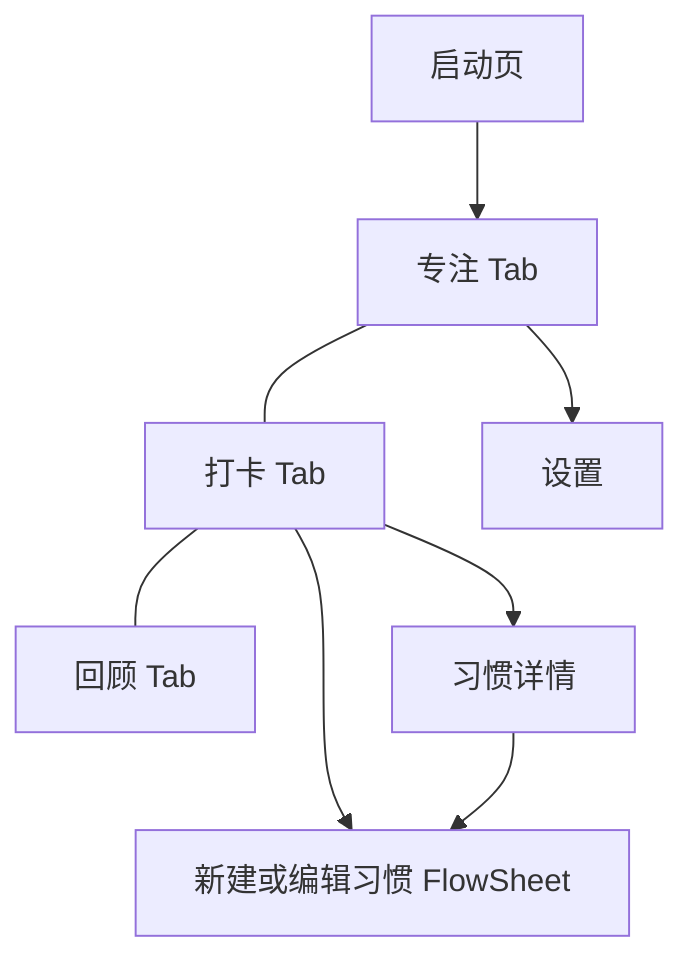

# 「一刻」原型

> 状态：未开始；核实日期：2026-10-16。本文是计划，不代表现行 Contract。
>
> 前置条件：[PBWork 与 PB 平台升级](./pbwork-platform-upgrade.md)达到「总退出标准」。本文中的产品定义只是草案，进入正式制作前要按[原型设计工作流](../pbwork/prototypes/design-workflow.md)写成 `apps/pbwork/src/prototypes/yike/docs/design.md`，并经用户批准。

## 目标

做一个真正能日常使用的个人工具原型，同时验证 PBWork 升级后的完整能力：原型自有品牌主题包、模式与主题色切换、启动页、底部 Tab 根导航、计时类交互、确定性时钟、新写法与新 DS 组件，以及正式定稿采集与 Handoff。

它不是演示页集合。判断标准是：用户愿意每天打开它专注和打卡，页面数量少但每一页都完成一件事。

## 前置条件检查

开始前逐项确认平台升级已交付以下能力；任何一项缺失，先在本节记录替代做法并取得用户同意，不能绕过平台约束。

| 依赖 | 来自 | 本计划用途 |
| --- | --- | --- |
| 原型主题包、模式与主题色轴、校验器 | 平台升级 W2 | 一刻的品牌主题、浅色/深色/跟随系统、四个主题色 |
| 主题一致性探针 | 平台升级 W3 | 深色等模式不重复采集，由探针守住结构一致 |
| `v-pb` / `pbStyle()`、就近声明的 Registry、`createPrototypeApp`、可声明时钟、脚手架 | 平台升级 W4 | 降低制作成本；固定采集时的“现在” |
| 第一批 DS 组件 | 平台升级 W5 | 见下文「组件归属」 |

## 产品定义（草案）

**一刻**是一款只在本机运行的专注与习惯小工具：打开就能开始一段专注，一次点击完成今天的打卡，回头能看见时间花在了哪里。

### 用户与情境

- 需要用番茄钟切分工作、学习时间的人；
- 想坚持几个小习惯（喝水、阅读、运动、早睡），但不想被复杂的习惯管理工具打扰的人；
- 偶尔需要正计时（计圈）或倒计时（煮面、平板支撑）的人。

### 产品承诺

任何时候打开一刻，首屏都能直接开始一段专注；完成的专注和打卡立即出现在回顾里。

### 设计原则

1. **打开即用**：没有登录、引导页或空白配置页；默认配置就能用。
2. **数字是主角**：计时数字是首屏唯一焦点，其它信息退为上下文。
3. **一次点击完成**：打卡一次点击完成，并且可以撤销。
4. **中断不丢失**：刷新、切走或误关后，计时与会话都能恢复。
5. **安静克制**：不用连续天数警告、徽章墙或羞耻文案制造压力。

### 非目标

- 不做登录、账号、云同步、服务端或社交；
- 不做真实系统通知与后台计时；提示音和振动只声明为交互意图，原型中以可见反馈代替；
- 不做白噪音、任务管理、日历同步或数据分析报表。

## 核心对象

| 对象 | 作用 | 关键状态 |
| --- | --- | --- |
| 专注会话 | 一次番茄、正计时或倒计时 | 未开始、进行中、暂停、休息中、本轮完成、已放弃、中断待恢复 |
| 番茄配置 | 专注时长、短休、长休、长休间隔 | 默认 25 / 5 / 15 分钟、每 4 轮长休 |
| 计圈记录 | 正计时中的分段 | 每圈用时、累计用时 |
| 习惯 | 名称、图标、频率（每日，或每周 N 次）、可选提醒时间 | 进行中、已归档 |
| 打卡记录 | 某天完成某个习惯 | 已打卡、已撤销 |
| 偏好 | 模式（浅色、深色、跟随系统）、主题色、提示音开关 | 立即生效并保存在本机 |

完成或提前结束的专注会话生成专注记录；放弃不生成记录。回顾页只从专注记录和打卡记录派生结果。

## 信息架构

- 底部三个根目的地：**专注**、**打卡**、**回顾**。计时（正计时、倒计时）是专注页内的模式，不单独占一个 Tab。
- 启动页只在冷启动出现，结束后替换为专注页，返回不会回到启动页。
- 设置从专注页工具行进入；打卡页右上角新建习惯。三个根页面只通过底部 Tab 互相切换，内容区不跨根跳转。
- 未决：设置入口是否在三个根页面的工具行都出现，在页面契约阶段决定。

## 页面与关键状态

| 页面 | 唯一职责 | 关键状态 |
| --- | --- | --- |
| 启动页 | 建立品牌识别，然后让路 | 品牌静帧；减少动效时直接显示静帧并立即进入 |
| 专注 | 开始并完成一段专注 | 番茄：待开始、进行中、暂停、短休、长休、本轮完成；正计时：待开始、进行中（含计圈列表）、暂停；倒计时：设置时长、进行中、到点；中断后恢复；放弃确认 |
| 打卡 | 完成今天的习惯 | 部分完成、全部完成、没有习惯（引导新建）、打卡后撤销提示 |
| 习惯详情 | 看一个习惯的坚持情况并管理它 | 年度热力图、每日与每周 N 次两种频率、编辑、归档或删除确认 |
| 新建或编辑习惯 | 用最少步骤建立一个习惯 | 名称与图标、频率、提醒；校验错误；保存后回到来源页 |
| 回顾 | 看最近一段时间花在了哪里 | 周、月视图；选中某天；没有记录 |
| 设置 | 调整模式、主题色、番茄时长和提示音 | 默认；主题色选择；时长选择；重置数据确认 |

每个页面在 `design.md` 中再写成完整的页面契约：首屏焦点、阅读顺序、热区与结果、关键状态、跨页分工和验收信号。

## 视觉方向：“安静的仪表”

- **视觉命题**：像一块安静的仪表盘，数字本身就是主角，不靠卡片堆叠来制造层次。
- **签名元素**：专注页的大号等宽数字，外面一圈细环表示进度；打卡与回顾沿用同一圈环和同一套数字字阶。
- **主题包**：
  - 模式：浅色用暖纸色背景，深色接近纯黑，另有跟随系统；
  - 主题色：番茄红（默认）、墨绿、靛蓝、琥珀，只替换 accent 一组键；
  - 字体：文本字族与数字字族各一个，数字字族必须支持等宽数字；具体字体在视觉方向阶段比较后确定，并附本地字体文件与许可证。
- **层级**：页面背景安静，大部分内容直接排在页面上；设置使用分组列表；全页只有一种强调色。
- **动效**：只服务计时推进、完成确认、浮层进出和模式切换；减少动效时信息与结果完整。
- **视口与可访问性**：首要视口为 `390 × 844`，窄屏不横向溢出；可交互元素有可读名称、完整触控区域和可见焦点；浅色、深色和四个主题色下层级与对比度一致。

视觉方向先用仓库内 `frontend-design` Skill 定稿，必要时在 `apps/pbwork/src/drafts/yike/` 做探索页比较，探索代码不进入正式原型。

## 组件归属

| 元素 | 归属 |
| --- | --- |
| 模式切换（番茄、正计时、倒计时）、回顾的周/月切换、设置的模式选择 | DS：SegmentedControl |
| 专注进度环、习惯完成环 | DS：RingProgress |
| 计时大数字、回顾中的统计数字 | DS：Metric、NumberTicker，配合 `font.numeric` |
| 番茄时长、倒计时时长、提醒时间 | DS：DurationPicker、TimePicker |
| 设置页、习惯详情的信息行 | DS：GroupedList、ListCell |
| 习惯年度热力图、回顾月历 | DS：Heatmap、MonthCalendar |
| 回顾的每日分钟柱 | DS：MiniBars |
| 打卡撤销 | DS：带撤销动作的 Snackbar |
| 放弃确认、删除确认 | DS：ActionSheet 或现有 Confirm |
| 启动页 | DS：LaunchScreen 模式 + BrandMark 插槽 |
| 专注表盘（环、数字、状态文案、主操作的组合） | 原型内部组合 |
| 打卡行（图标、名称、本周进度、一次点击完成） | 原型内部 |
| 启动动效 | 原型内部，声明资产 ID、时长、降级方式 |

实施时如发现某个元素需要的能力 DS 还没有，先按 DS 规则补齐，不在原型内重造与 DS 形状相同的组件。完整的 Promotion Mapping 写入 `apps/pbwork/src/prototypes/yike/docs/implementation.md`。

## Evidence 方案

- **时钟**：原型声明固定的“现在”（例如某个工作日上午），采集时所有日期、问候语和回顾数据都基于它；交互模式使用真实时间。
- **计时状态**：采集用的 Variant 冻结计时数值（如“进行中，剩余 12:34”“暂停于 08:02”），不依赖采集期间实际走表。
- **Scenario**：至少覆盖开始专注、暂停与继续、完成一轮进入休息、放弃确认、正计时计圈、倒计时到点、打卡与撤销、新建习惯、切换主题色、中断后恢复。
- **主题**：Case 只采默认模式；其它模式与主题色由主题一致性探针和主题包固定取值保证。
- **规模**：按上表的页面与状态估算约 40–70 个 Case，低于 200 上限；以实际 Preflight 结果为准，并记录在本计划进度表。

## 执行步骤与门禁

| 步骤 | 产出 | 门禁 |
| --- | --- | --- |
| 1. 视觉方向 | 视觉命题、字体与色板候选、必要的探索页 | 用户选定方向 |
| 2. 产品基线 | `design.md`（产品定义、信息架构、核心旅程、共享视觉语法、页面设计状态） | 用户批准，`status: approved` |
| 3. 页面契约 | 逐页或按旅程批次写入 `design.md` | 页面状态为 approved 才进入正式制作 |
| 4. 主题包 | `prototypes/yike/theme/`，含两种模式、四个主题色、字体文件 | 校验器通过；在 Playground 中用一刻主题包渲染全部 DS 组件，用户评审通过 |
| 5. 正式页面 | 用脚手架起步，按新写法实现全部页面 | Delivery Gate 通过；主题一致性探针通过 |
| 6. 体验检查 | 每个页面完成 Quick Experience Check，结果写入 `implementation.md` | 有实质问题时升级为 Focused Experience Gate |
| 7. 正式定稿 | 在 PBWork 中定稿并采集整个原型 | 全部 Case captured，Handoff 与 Delivery 绑定，stage `final` |

可选的后续项：用这次的 Handoff 交给 Flutter Target 做一次端到端还原，验证新 DS 组件的 `pending` 映射如何影响 Agent 交付。这一项不属于本计划的完成定义。

## 进度

| 步骤 | 状态 | 证据 / 剩余缺口 |
| --- | --- | --- |
| 前置条件检查 | 未开始 | — |
| 1. 视觉方向 | 未开始 | — |
| 2. 产品基线 | 未开始 | — |
| 3. 页面契约 | 未开始 | — |
| 4. 主题包 | 未开始 | — |
| 5. 正式页面 | 未开始 | — |
| 6. 体验检查 | 未开始 | — |
| 7. 正式定稿 | 未开始 | — |

## 验收信号

- 专注、打卡、回顾三个根页面各能用一句不重叠的话说明职责，每个根页面首屏只有一个最高视觉焦点。
- 打开应用后一次点击即可开始专注；专注可以暂停与继续，刷新或中断后恢复到同一状态。
- 番茄完成一轮后进入休息；正计时可以计圈；倒计时到点有明确的可见反馈。
- 打卡一次点击完成，可以撤销；打卡与专注完成后，回顾立即变化。
- 浅色、深色、跟随系统与四个主题色下层级、对比度一致；主题一致性探针通过。
- 原型中没有硬编码的设计值，没有在原型内重造与 DS 形状相同的组件。
- 正式定稿完成，Handoff 可通过 MCP 读取，包括主题包与时钟声明。
