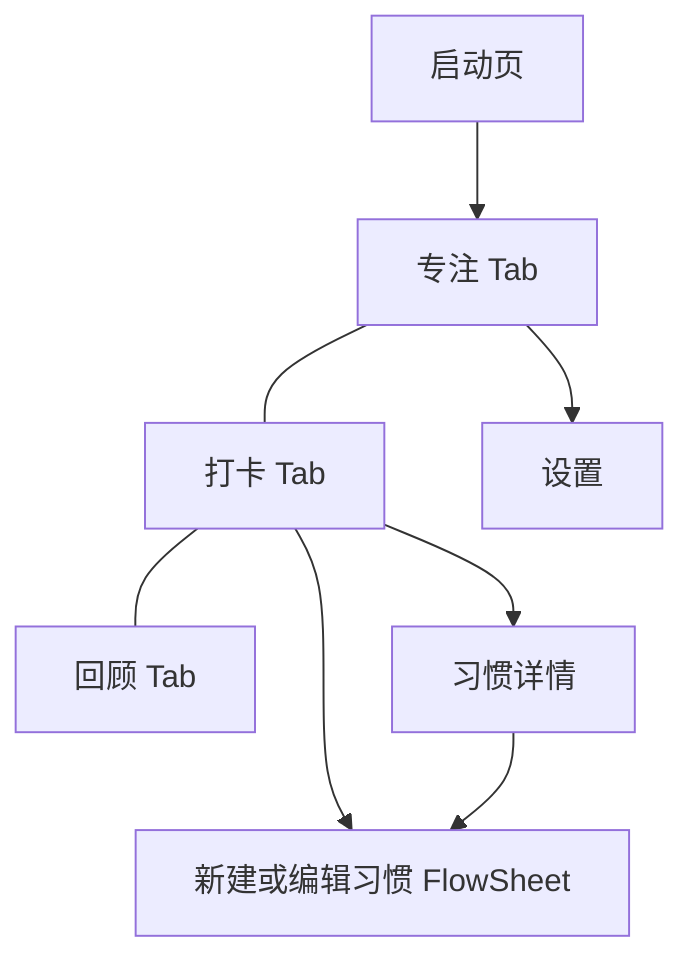

# 「一刻」原型

> 状态：开工收口中（产品基线与页面契约已闭合，平台总验收执行中）；核实日期：2026-10-18。本文是计划，不代表现行 Contract。
>
> 前置条件：[PBWork 与 PB 平台升级](./pbwork-platform-upgrade.md)达到「总退出标准」，包括新增第 6 步设计基础与组件预览迁移；本计划在其后另开对话实施。产品与交互唯一基线为已批准的[一刻设计文档](../../apps/pbwork/src/prototypes/yike/docs/design.md)。2026-10-18 用户明确后台继续计时、零历史并预置可删除习惯、追加一分钟合并记录，并授权 Agent 闭合页面契约；下文产品概要不替代该基线。

## 目标

做一个真正能日常使用的个人工具原型，同时验证 PBWork 升级后的完整能力：原型自有品牌主题包、浅色/深色/跟随系统模式、启动页、底部 Tab 根导航、计时类交互、确定性时钟、新写法与新 DS 组件，以及正式定稿采集与 Handoff。

它不是演示页集合。判断标准是：用户愿意每天打开它专注和打卡，页面数量少但每一页都完成一件事。

## 前置条件检查

开始前逐项确认平台升级已交付以下能力；任何一项缺失，先在本节记录替代做法并取得用户同意，不能绕过平台约束。

| 依赖 | 来自 | 本计划用途 |
| --- | --- | --- |
| 原型主题包、一个包多套主题、模式、校验器 | 平台升级第 2 步 | 一刻的三套表盘主题（每套单一品牌色），浅色/深色/跟随系统，运行时按偏好切换 |
| 主题身份进入 Evidence、Handoff 固定键值表、MCP 读取 | 平台升级第 3 步 | 交付端命中键名取值；取值与 Evidence 不一致即视为某一环有问题 |
| 主题一致性探针 | 平台升级第 3 步 | 深色等模式不重复采集，由探针守住结构一致 |
| 可声明时钟 | 平台升级第 3 步 | 固定采集时的“现在”，日期与回顾数据可复现 |
| `v-pb` / `pbStyle()`、就近声明的 Registry、`createPrototypeApp`、脚手架 | 平台升级第 4 步 | 降低制作成本；样板代码由共享套件承担 |
| 通用 DS 组件 | 平台升级第 5 步 | 见下文「组件选用」 |
| 设计基础与组件手机预览、主题选择及按需对比 | 平台升级第 6 步 | 先验证平台预览承载能力；正式制作时接入一刻真实主题与扩展 |

字体不在依赖内：一刻的正式页面使用 PBWork 默认字体，草稿里按表盘切换字体的做法是失误，已统一为默认字体。

## 已确认的 brief（2026-10-16）

| 字段 | 结论 |
| --- | --- |
| 产品定位与核心场景 | 只在本机运行的专注与习惯小工具，专注与打卡并重：打开就能开始专注，一次点击完成打卡，回头能看见时间花在了哪里 |
| 用户群体 | 上班族与知识工作者、学生与备考人群、想坚持小习惯又怕工具复杂的人、偶尔需要正计时或倒计时的人，以及用户本人日常使用 |
| 风格 | 极简留白、自然舒缓、实物感、安静克制；没有参照 App |
| 平台与视口 | iOS 与 Android 双端手机，以 iOS 观感为准；首要视口 `390 × 844` |
| 功能范围 | 必做：番茄钟、正计时与计圈、倒计时、习惯打卡、习惯详情、回顾、启动页、设置、中断恢复；无可选项；非目标见下文 |
| 品牌起点 | 全新品牌；浅色、深色、跟随系统三种模式。2026-10-16 修订：提供机械、水位、日影三种表盘，每种表盘是一整套主题（配色、签名图形、打卡标记；字体统一为默认字体），各自只有一个品牌色；在设置中切换；打卡页统一使用打孔卡布局 |
| Flutter 交付约束 | 2026-10-16 更新：大概率交付到现有 Flutter App；具体 App 及其主题、组件、路由约定在 Target 还原前确认 |

## 产品定义概要

**一刻**是一款只在本机运行的专注与习惯小工具：打开就能开始一段专注，一次点击完成今天的打卡，回头能看见时间花在了哪里。

### 用户与情境

- 需要用番茄钟切分工作、学习时间的上班族、学生与备考人群；
- 想坚持几个小习惯（喝水、阅读、运动、早睡），但不想被复杂的习惯管理工具打扰的人；
- 偶尔需要正计时（计圈）或倒计时（煮面、平板支撑）的人；
- 用户本人的日常使用。

### 产品承诺

任何时候打开一刻，首屏都能直接开始一段专注；完成的专注和打卡立即出现在回顾里。

### 设计原则

1. **打开即用**：没有登录、引导页或空白配置页；默认配置就能用。
2. **数字是主角**：计时数字是首屏唯一焦点，其它信息退为上下文。
3. **一次点击完成**：打卡一次点击完成，并且可以撤销。
4. **会话连续**：切到后台继续计时；刷新或关闭后从保存进度暂停恢复，不补计关闭期间。
5. **安静克制**：不用连续天数警告、徽章墙或羞耻文案制造压力。

### 非目标

- 不做登录、账号、云同步、服务端或社交；
- 不做真实系统通知、系统后台服务或关闭后的持续计时；后台返回按实际经过时间校准，提示音和振动以可见反馈表达；
- 不做白噪音、任务管理、日历同步或数据分析报表。

## 核心对象

| 对象 | 作用 | 关键状态 |
| --- | --- | --- |
| 专注会话 | 一次番茄、正计时或倒计时 | 未开始、进行中、暂停、休息中、本轮完成、已放弃、中断待恢复 |
| 番茄配置 | 专注时长、短休、长休、长休间隔 | 默认 25 / 5 / 15 分钟、每 4 轮长休 |
| 计圈记录 | 正计时中的分段 | 每圈用时、累计用时 |
| 习惯 | 名称、图标、频率（每日，或每周 N 次）、可选提醒时间 | 进行中、已归档 |
| 打卡记录 | 某天完成某个习惯 | 已打卡、已撤销 |
| 偏好 | 表盘（机械、水位、日影）、模式（浅色、深色、跟随系统）、番茄时长、提示音开关 | 立即生效并保存在本机 |

完成或提前结束的专注会话生成专注记录；放弃不生成记录。倒计时首次到点即出现记录，追加一分钟更新同一记录，最终只计一次会话。首次零历史，预置四个可删除习惯；统计与恢复的详细口径见设计基线。

## 信息架构

- 底部三个根目的地：**专注**、**打卡**、**回顾**。计时（正计时、倒计时）是专注页内的模式，不单独占一个 Tab。
- 启动页只在冷启动出现，结束后替换为专注页，返回不会回到启动页。
- 设置从专注页工具行进入；打卡页右上角新建习惯。三个根页面只通过底部 Tab 互相切换，内容区不跨根跳转。
- 设置只从专注页进入；回顾空态通过文字引导底部导航，不提供内容区跨根跳转按钮。

## 页面与关键状态

| 页面 | 唯一职责 | 关键状态 |
| --- | --- | --- |
| 启动页 | 建立品牌识别，然后让路 | 品牌静帧；减少动效时直接显示静帧并立即进入 |
| 专注 | 开始并完成一段专注 | 番茄：待开始、进行中、暂停、短休、长休、本轮完成；正计时：待开始、进行中（含计圈列表）、暂停；倒计时：设置时长、进行中、到点；中断后恢复；放弃确认 |
| 打卡 | 完成今天的习惯 | 部分完成、全部完成、没有习惯（引导新建）、打卡后撤销提示 |
| 习惯详情 | 看一个习惯的坚持情况并管理它 | 年度热力图、每日与每周 N 次两种频率、编辑、归档或删除确认 |
| 新建或编辑习惯 | 用最少步骤建立一个习惯 | 名称与图标、频率、提醒；校验错误；保存后回到来源页 |
| 回顾 | 看最近一段时间花在了哪里 | 周、月视图；选中某天；没有记录 |
| 设置 | 选择表盘，调整模式、番茄时长和提示音 | 默认；表盘选择；模式选择；时长选择；重置数据确认 |

全部页面契约已在 `design.md` 中形成，包含首屏焦点、阅读顺序、热区与结果、关键状态、跨页分工和验收信号；三批均按 2026-10-18 用户范围授权标记 approved，尚未实现。

## 视觉方向（三套表盘主题，草稿已通过）

按[原型设计工作流](../pbwork/prototypes/design-workflow.md)完成需求采访后，应用仓库内 `frontend-design` 做了三个方向的风格草稿。用户在 2026-10-16 决定三者都保留，作为可切换的表盘：

- **机械番茄钟**（A 的延续）：扇面表盘，柿子色、哑光瓷白底；打卡是在本周那一格打孔；
- **水位**：剩余时间是一面缓慢下降的水平面，数字半浸在水中，暂停时水面静止；石灰底、苔绿；打卡是往格子里滴一滴水；
- **日影**：剩余时间是一道在纸面上慢慢扫过的软影；暖灰纸面、靛蓝；打卡是盖一枚刻着习惯首字的印章。

决定：

- 每种表盘是一整套主题，切换表盘同时切换配色、签名图形和打卡标记，字体不随表盘变化；
- 打卡页在三套主题中都使用打孔卡布局（周历孔位 + 右侧打卡按钮），只换主题；
- 在设置页切换表盘；
- 全部页面草稿位于 `apps/pbwork/src/drafts/yike/styles/`，在 `/workbench/drafts/yike` 按主题浏览（`?face=mechanical|water|sundial`，`&theme=dark` 看深色）；`?view=a` 打开早期的可交互 A。

平台已支持「一个原型、多套主题、每套两种模式」及运行时偏好切换，一刻按三套完整主题制作，不启用基础外观降级。字体不属于主题差异，三套表盘统一使用默认字体；一刻真实取值和签名图形仍需制作与验证。

不随方向变化的约束：首要视口为 `390 × 844`，窄屏不横向溢出；可交互元素有可读名称、完整触控区域和可见焦点；减少动效时信息与结果完整；所有模式下层级与对比度一致。

## 组件选用

组件在视觉方向选定后按 [Promotion Mapping](../pbwork/prototypes/design-workflow.md#promotion-mapping) 自上而下选用，并写入 `apps/pbwork/src/prototypes/yike/docs/implementation.md`。与所选风格冲突时以风格为准，改用 DS 扩展或原型自有组件并记录 DS 缺口。

下表只列出平台升级第 5 步中可能承接这些元素的 DS 候选，不预设最终归属；清单之外的组件按 Promotion Mapping 在制作中按需进入 DS：

| 元素 | 可能的 DS 候选 |
| --- | --- |
| 模式切换、回顾的周/月切换、设置的模式选择 | SegmentedControl |
| 专注进度、习惯完成进度 | RingProgress |
| 计时大数字、回顾中的统计数字 | Metric、NumberTicker |
| 番茄时长、倒计时时长、提醒时间 | DurationPicker、TimePicker |
| 设置页、习惯详情的信息行 | GroupedList、ListCell |
| 习惯年度热力图、回顾月历 | Heatmap、MonthCalendar |
| 回顾的每日分钟柱 | MiniBars |
| 打卡撤销 | 带撤销动作的 Snackbar |
| 放弃确认、删除确认 | ActionSheet 或现有 Confirm |
| 启动页 | LaunchScreen 模式 + BrandMark 插槽 |

专注表盘、打卡行和启动动效预计是原型自有组件或外部资产，最终以 Promotion Mapping 为准。

## Evidence 方案

- **时钟**：原型声明固定的“现在”（例如某个工作日上午），采集时所有日期、问候语和回顾数据都基于它；交互模式使用真实时间。
- **计时状态**：采集用的 Variant 冻结计时数值（如“进行中，剩余 12:34”“暂停于 08:02”），不依赖采集期间实际走表。
- **Scenario**：至少覆盖开始专注、暂停与继续、完成一轮进入休息、放弃确认、正计时计圈、倒计时到点、打卡与撤销、新建习惯、切换外观模式、中断后恢复。
- **主题**：Case 只采默认模式；其它模式由主题一致性探针和主题包固定取值保证。
- **规模**：按上表的页面与状态估算约 40–70 个 Case，低于 200 上限；以实际 Preflight 结果为准，并记录在本计划进度表。

## 执行步骤与门禁

| 步骤 | 产出 | 门禁 |
| --- | --- | --- |
| 0. 需求采访 | 确认 brief 七个字段，修订本计划的产品草案 | 用户确认 brief 摘要 |
| 1. 视觉方向 | 应用 `frontend-design` 呈现两到三个方向，必要的风格草稿 | 用户选定方向 |
| 2. 产品基线 | `design.md`（产品定义、信息架构、核心旅程、共享视觉语法、页面设计状态） | 用户批准，`status: approved` |
| 3. 页面契约 | 逐页或按旅程批次写入 `design.md` | 页面状态为 approved 才进入正式制作 |
| 4. 主题包 | `prototypes/yike/theme/`，含机械、水位、日影三套主题，每套两种模式、单一品牌色 | 校验器通过；在 Playground 中用每套主题渲染全部 DS 组件，用户评审通过 |
| 5. 正式页面 | 用脚手架起步，按新写法实现全部页面 | Delivery Gate 通过；主题一致性探针通过 |
| 6. 体验检查 | 每个页面完成 Quick Experience Check，结果写入 `implementation.md` | 有实质问题时升级为 Focused Experience Gate |
| 7. 正式定稿 | 在 PBWork 中定稿并采集整个原型 | 全部 Case captured，Handoff 与 Delivery 绑定，stage `final` |

可选的后续项：用这次定稿的 Handoff 做一次交付端还原，验证主题包键值表如何影响 Agent 交付。这一项不属于本计划的完成定义，本轮不处理交付端。

## 进度

| 步骤 | 状态 | 证据 / 剩余缺口 |
| --- | --- | --- |
| 前置条件检查 | 平台总验收执行中 | 2026-10-18：基础检查与单测已通过；全量浏览器回归发现并修复弹层焦点等待的测试竞态，补齐 MCP 固定时钟读取；修复后整批回归结果见平台计划总验收记录。 |
| 0. 需求采访 | 已完成 | 三轮结构化采访，用户于 2026-10-16 确认 brief（见「已确认的 brief」）；Flutter 交付约束后续更新为大概率使用现有 App |
| 1. 视觉方向 | 已完成 | 用户决定三套表盘主题都保留、在设置中切换、打卡页统一打孔卡。`drafts/yike/styles/` 有三套主题的全部页面草稿，每套 28 屏（启动、专注 12 种状态、打卡 4 种、习惯详情与编辑 5 种、回顾 4 种、设置 2 种），浅色与深色均可浏览；用户于 2026-10-16 通过草稿 |
| 2. 产品基线 | 已完成 | `apps/pbwork/src/prototypes/yike/docs/design.md` 于 2026-10-16 批准（`status: approved`），9 条假设全部同意；2026-10-18 同步后台计时、首次数据、追加合并及页面契约，三套主题按完整风格制作 |
| 3. 页面契约 | 已闭合 | 2026-10-18：用户范围授权下完成启动、专注、打卡、习惯详情、编辑、回顾和设置契约；包含后台/重开区别、秒级统计和跨日分配、追加合并、首次数据与管理边界。详见设计基线，页面未实现。 |
| 4. 主题包 | 未开始 | — |
| 5. 正式页面 | 未开始 | — |
| 6. 体验检查 | 未开始 | — |
| 7. 正式定稿 | 未开始 | — |

## 验收信号

- 专注、打卡、回顾三个根页面各能用一句不重叠的话说明职责，每个根页面首屏只有一个最高视觉焦点。
- 打开应用后一次点击即可开始专注；专注可以暂停与继续，后台返回按实际经过时间校准；刷新或关闭后暂停恢复，不补计关闭时间。
- 番茄完整结束后可开始休息，休息结束不自动开始下一轮；正计时可以计圈；倒计时到点有明确的可见反馈。
- 打卡一次点击完成，可以撤销；打卡与专注完成后，回顾立即变化。
- 浅色、深色与跟随系统下层级、对比度一致；主题一致性探针通过。
- 原型中没有硬编码的设计值；组件选用符合 Promotion Mapping，原型自有组件与 DS 扩展都记录了 DS 缺口。
- 正式定稿完成，Handoff 可通过 MCP 读取，包括主题包与时钟声明。
